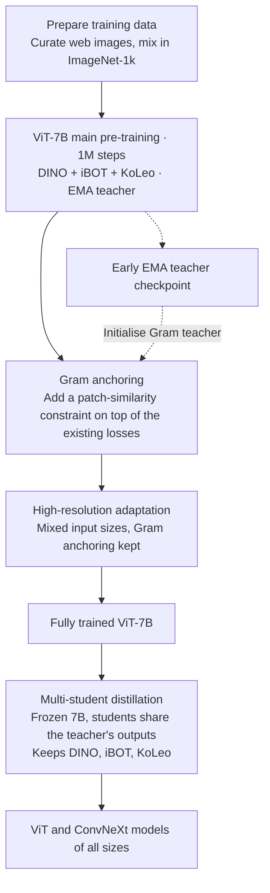

## Before we begin

Since its release in August 2025, [[(2025 arXiv) DINOv3|DINOv3]] seems to have gained an overwhelming advantage across every area of computer vision. Although the authors say its pre-training dataset — LVD-1689M — comes mainly from public Instagram posts (most of which are probably natural images), I've found that its linear probing performance on medical images is seriously strong too 💪! I tried X-ray (RSNA-Pneumonia image classification), ultrasound (BUSI lesion segmentation), CT (AbdomenCT-1K 3D organ segmentation) and MRI (PI-CAI lesion detection). Across all of these tasks, DINOv3 held its own pretty well. And that's how DINOv3 turned me into a fan. So I figured I might as well start a series and take notes as I read the paper.

![[AQNSeRC9WFZk11lhl4BUzaQZh4Lj5jQ5OEVMB2iJLKoj9wSYZWhbWhuqEeEbYx6XgOSacjknkoLJNNR8YgZGaKRI.mp4]]

## Abstract

The abstract first explains why Self-Supervised Learning (SSL) is easy to scale up (because the images don't need to be annotated), then points out the two kinds of images the paper focuses on — natural images and aerial images.

Then the authors start blowing their own trumpet. "a major milestone" (OK, no objection from me), "simple yet effective" (no objection whatsoever to the effective part, but is DINOv3 really simple?).

Next, it lays out the paper's contributions:

1. **Bigger and stronger**: more data, bigger model.
2. **Introducing Gram anchoring**: fixes the problem of dense features getting worse after long training. In the paper, ImageNet classification is still climbing while VOC segmentation has already started losing points.
3. **After-sales service**: after training the 7B-parameter monster, some adjustments for high resolution, smaller models and text alignment.

## Introduction

Self-supervised learning (SSL) is an effective way to train visual foundation models ("FMs" for short). It finds training signals directly in image pixels, using patterns that often appear together in images. For example, in a photo of a face, the eyebrows, eyes, nose and mouth usually have a fairly fixed spatial relationship.

![[Pasted image 20261113103656.png|An image of a beautiful woman generated by ChatGPT in the style of Darren Coffield's Masters of Reality series.|320]]

Take that face photo: if there's only the image, with no caption, and nobody has ever labelled it, can it be used for training?
- **Fully supervised learning** (e.g. [[(2023 ICML) Scaling Vision Transformers to 22 Billion Parameters|ViT-22B]]) needs class labels first.
- **Text-based weakly supervised learning** (e.g. [[(2021 ICML) Learning Transferable Visual Models From Natural Language Supervision|CLIP]] and [[(2025 NeurIPS) Perception Encoder The best visual embeddings are not at the output of the network|Perception Encoder]]) uses image–text pairs, so you at least need a piece of text that goes with the image.
But self-supervised learning doesn't need any of that crap. There are loads of tricks you can play, e.g. masking a small patch of the eye and having the model predict that patch's features from the eyelashes and eyelid showing around it. That way, a huge pile of photos that never had captions or labels can also be used for pre-training.

Another advantage of self-supervised learning is that it doesn't aim to optimise a specific task (such as classification, segmentation, detection and so on) (PS: there's still a pretext task, and how good that pretext task is directly determines the quality of the model after self-supervised learning). Then the authors go on to praise their previous work, [[(2024 TMLR) DINOv2 Learning Robust Visual Features without Supervision|DINOv2]], saying how strong its linear probing performance is, blah blah. Next, the authors list several examples of using self-supervised learning on scientific data, four of which use DINOv2.
- **Histopathology**. [[(2024 Nature Medicine) A foundation model for clinical-grade computational pathology and rare cancers detection|Virchow]] uses DINOv2's training method, cutting about 1.5 million pathology slides into small tiles to train its own ViT. For cancer detection, the tile features from the same specimen are then aggregated.
- **Biology**. [[(2025 Scientific Reports) Self-supervision advances morphological profiling by unlocking powerful image representations|Kim et al.]] use the original [[(2021 ICCV) Emerging Properties in Self-Supervised Vision Transformers|DINO]], [[(2020 ICML) A Simple Framework for Contrastive Learning of Visual Representations|SimCLR]] and [[(2022 CVPR) Masked Autoencoders Are Scalable Vision Learners|MAE]] to learn morphological features from cell microscopy images.
- **Medical imaging**. [[(2025 Nature Machine Intelligence) Exploring scalable medical image encoders beyond text supervision|RAD-DINO]] starts from pre-trained DINOv2 ViT-B weights and continues self-supervised training on chest X-rays.
- **Remote sensing**. [[(2022 NeurIPS) SatMAE Pre-training Transformers for Temporal and Multi-Spectral Satellite Imagery|SatMAE]] ~~has zilch to do with the DINO family of models~~ uses MAE, masking part of a satellite image and then reconstructing it. [[(2024 RSE) Very high resolution canopy height maps from RGB imagery using self-supervised vision transformer and convolutional decoder trained on aerial lidar|Tolan et al.]] use DINOv2's method to pre-train an encoder on 18 million satellite images, then freeze it and use airborne lidar data to train a decoder that predicts canopy height.
- **Astronomy**. [[(2024 MNRAS) AstroCLIP A Cross-Modal Foundation Model for Galaxies|AstroCLIP]] trains a galaxy image encoder with a modified DINOv2 method, then aligns the image features with the spectral features of the same galaxy.
- **High-energy particle physics**. [[(2022 SciPost Physics) Symmetries, safety, and self-supervision|JetCLR]] uses contrastive learning to learn features from simulated particle jets. The authors put it here to ~~pad out the list~~ give an example of self-supervised learning in high-energy particle physics.

```ad-rem
title: 🍉 A tangent: is the DINO team doing version updates too?
collapse: closed

Having studied the technical evolution of DINOv2 and DINOv3, why not dig into the team of authors behind them as well? After all, model architectures get upgraded and training data gets expanded, **and research team line-ups change too — and the story may be even better than the papers.**

**🦖 Act I: The model got upgraded, and so did the author line-up**

In 2021, the original DINO burst onto the scene, with **Mathilde Caron** as first author, backed by a host of computer vision veterans such as Hervé Jégou, Julien Mairal, Piotr Bojanowski and Armand Joulin.

By DINOv2 in 2023, the three co-first authors had become [**Maxime Oquab**](https://scholar.google.com/citations?user=5vteYV8AAAAJ), [**Timothée Darcet**](https://scholar.google.com/citations?user=G4qOJQEAAAAJ) and [**Théo Moutakanni**](https://scholar.google.com/citations?user=nN2MKGwAAAAJ).

Then with DINOv3 in 2025, the first five authors changed to [**Oriane Siméoni**](https://scholar.google.com/citations?user=PC7ELtEAAAAJ), [**Huy V. Vo**](https://scholar.google.com/citations?user=gIf5VqUAAAAJ), [**Maximilian Seitzer**](https://scholar.google.com/citations?user=3eo5KlIAAAAJ), [**Federico Baldassarre**](https://scholar.google.com/citations?user=0iy5EucAAAAJ) and [**Maxime Oquab**](https://scholar.google.com/citations?user=5vteYV8AAAAJ).

Interestingly, **the DINOv2 and DINOv3 papers each have 26 authors, but only 12 overlap**. A line-up refresh on that scale feels rather like a football team that has swapped out half its starting XI yet is still a title contender.

Look closely at the list, though, and you'll notice that Maxime Oquab has stayed near the front for two generations in a row, and senior researchers such as [**Piotr Bojanowski**](https://scholar.google.com/citations?user=lJ_oh2EAAAAJ) and [**Hervé Jégou**](https://scholar.google.com/citations?user=1lcY2z4AAAAJ) have been there throughout.

It seems DINO's secret isn't just Self-Distillation, but also a rather well-established "old hands mentor the newcomers" system.

Of course, author order on a paper can't be equated directly with organisational status or size of contribution, but from the angle of how the team has evolved, you can certainly spot plenty of interesting clues.

**🥐 Act II: Following the trail, it turns out DINO's home is actually in Paris**

Keep digging into these authors' CVs and a very interesting geographical pattern emerges: **the core research force behind the DINO series has long been concentrated at Meta FAIR Paris (Meta's Paris lab for fundamental AI research).**

As early as [an official post in June 2023](https://about.fb.com/news/2023/06/a-spotlight-on-the-four-emea-tech-hubs-pioneering-metas-ai-research-around-the-world/), Meta stated clearly that DINOv2 was a major achievement of its Paris research team. The FAIR Paris lab was founded in 2015 and is also one of Meta's most important European AI research bases.

So DINO didn't move from the US to Paris; rather, **this dinosaur has had strong Parisian blood from its early days**.

Even more interesting: DINOv3's first author, Oriane, and second author, Huy, had actually already collaborated on [[(2021 BMVC) Localizing Objects with Self-Supervised Transformers and no Labels|LOST]] back in 2021.

At the time, both had research collaborations with Paris-based Valeo.ai (a French autonomous driving company), and LOST itself uses the original DINO's self-supervised features for label-free object localisation.

In other words, **two of DINOv3's key players had already started working out how to use DINO's visual representations before DINOv2 was even born.**

This is no scratch team; it's old partners reuniting on the same technical path years later.

As luck would have it, in 2022 Oriane served as one of the invited members of Huy's PhD defence committee. In September 2024, she officially joined the DINO team at Meta FAIR, and the following year she became DINOv3's first author.

From Valeo.ai to Meta FAIR, from LOST to DINOv3, Paris's self-supervised vision research circle gives off a real "after all the twists and turns, it's still you" feeling.

**🧀 Act III: A farewell post that accidentally revealed the DINO team's daily life**

The story of DINOv3's fourth author, Federico Baldassarre, is especially interesting.

He originally did his PhD at KTH Royal Institute of Technology in Sweden, and in September 2023 moved to Paris specifically to join the DINO team at Meta FAIR as a postdoc.

In his two years on the team, he worked on projects including [[(2025 TMLR) Cluster and Predict Latent Patches for Improved Masked Image Modeling|CAPI]], [[(2025 CVPR) DINOv2 Meets Text A Unified Framework for Image- and Pixel-Level Vision-Language Alignment|dino.txt]], [[(2025 arXiv) Back to the Features DINO as a Foundation for Video World Models|DINO-world]] and DINOv3, with his research gradually extending from visual representations to vision–language alignment and world models.

When he left Meta in 2025, Federico published an extremely informative [LinkedIn farewell post](https://www.linkedin.com/posts/federicobaldassarre_today-marks-my-last-day-of-postdoc-at-meta-activity-7376732469187874816-x2N-).

The post not only thanked the research team, but also casually revealed the DINO team's organisational structure.

He explicitly mentioned that the team's two managers are **Piotr Bojanowski and Patrick Labatut**, and humorously called them the team's *Yin and Yang*: one leaning more towards scientific research, the other more towards engineering practice, the two complementing each other.

That fits the DINO series perfectly: in the papers it's elegant Self-Supervised Learning; behind the papers it's massive data cleaning, distributed training, compute scheduling and engineering optimisation.

After all, **if you want to train a Vision Transformer to billions of parameters, elegant maths alone won't cut it; you also need someone in charge of keeping the GPUs from blowing up.**

Federico also specially thanked the researchers and engineers on the team, even giving them some very down-to-earth nicknames: Huy is the "soup chef", Maximilian is "the one who appreciates good code", and Oriane is his research discussion partner.

The funniest bit is their team-building activities: planting glass terrariums, building the Eiffel Tower out of Lego, making cheese boards by hand...

All I can say is: **train DINO by day, study Cheese by night, keeping a firm grip on both research and the French way of life.**

That said, Federico didn't say goodbye to Paris after leaving Meta. According to his [personal homepage](https://baldassarrefe.github.io/), in December 2025 he joined **Mistral AI**, also based in Paris, to continue working on multimodal foundation models.

No more raising dinosaurs; now he's off studying the mistral (the mistral is a wind in France).

**✈️ Act IV: People moved on, but the Paris research circle didn't break up**

Federico isn't the only core DINO member to have left Meta.

[**Armand Joulin**](https://scholar.google.com/citations?user=kRJkDakAAAAJ), a key author of the original DINO and of DINOv2 and once a senior research lead at FAIR, left Meta for Apple in 2023 and later moved on to Google DeepMind.

Even more amusingly, **his workplace at Google DeepMind is also in Paris**.

Mathilde Caron, first author of the original DINO, has also joined Google DeepMind Paris.

This is borne out by the [[(2025 PLOS Computational Biology) Cell-DINO Self-supervised image-based embeddings for cell fluorescent microscopy|Cell-DINO]] paper published in December 2025: Mathilde Caron and Armand Joulin both list their affiliation as Google DeepMind, Paris, France.

What's more, Meta FAIR researchers such as Théo Moutakanni, Camille Couprie and Piotr Bojanowski also appear on this paper.

In other words, even if some of them are no longer at the same company, **they may still be in the same city and the same research field.**
```

DINOv2 had already mitigated training instability and representation collapse. But once you really try to make the model bigger and train it for longer, three new problems pop up.
1. **With so many images, how do you choose?** When you've got a huge pile of unlabelled images, how do you pick out the ones that are actually useful for training?
2. **Having to decide how long to train before you've even started?** With a cosine learning-rate schedule, you usually have to fix the total number of steps in advance so that the learning rate drops to a preset value at the final step. But with that much data, who knows before the run how many steps will be enough?
3. **Why does segmentation lose points the longer you train?** On models larger than ViT-Large (about 300M parameters), the authors found that late in training, the similarity maps of patch features get messier and messier.
To solve these problems, DINOv3 was born.

### A powerful all-rounder

![[Pasted image 20261113134926.png]]

DINOv3 wants to be an all-rounder in two respects:
- **One (feature) map, many uses.** An image goes through the backbone just once, and the extracted features can be shared by classification, segmentation and other tasks. Each task plugs in its own head, the backbone parameters stay frozen, and the results can still go toe-to-toe with specialised models.
- **The training method works across domains too.** Self-supervised pre-training doesn't rely on metadata, so it works on both web images and scientific observation images.
	- Figure 1(d) uses DINOv3 trained on aerial imagery. The authors compress each patch's features into three numbers with PCA and then plot them as RGB. Farmland, roads and houses can all be clearly told apart.

### High-quality feature maps from Gram anchoring

![[Pasted image 20261113154124.png|The figure that made DINOv3 legendary. With SSL alone, the model can clearly tell which things look like bananas, pumpkins, melons and mandarins.]]

DINOv3's self-supervised training has two goals:
- make the model excel at high-level semantic tasks,
- while also learning high-quality dense features that geometric tasks such as depth estimation and 3D matching can use straight out of the box (with a little post-processing at most).
The trouble is that these two goals can hold each other back during optimisation. The bigger the model and the longer the training, the more likely it is that global representations keep getting better while dense representations actually get worse. To tackle this, the authors introduce a Gram anchoring loss to mitigate the degradation of dense features.

Note that, specifically to compute the Gram anchoring loss, DINOv3 introduces another teacher model, which is different from the EMA teacher.

```ad-que
collapse: closed

Could it be that the two losses just weren't balanced properly? Gram anchoring is certainly mathematically elegant, but is it really necessary? Anyway, the authors don't report in the paper any results for leaving out Gram anchoring and only tuning the DINO loss and the iBOT loss.
```

### The DINOv3 family

![[Pasted image 20261113155547.png|Performance of the DINOv3 family.]] ^1bnhkq

First a 7B model is trained with the DINOv3 framework, and then it is used to distil a series of smaller models:
- **ViT**: small, base, large, huge.
- **ConvNeXt**: tiny, small, base, large.
Then the authors found that ViT-Large's performance is, amazingly, close to that of the ViT-7B teacher?! In other words, we ordinary players can just play around with ViT-Large; there's really no need to bother with the 7B.

```ad-que
collapse: closed

How come, in the (a) Semantic segmentation (ADE20k) plot in [[手撕 DINOv3 ：01 – 摘要与引言#^1bnhkq]], the fourth blue model counting from the left seems to have (slightly) worse performance than the third?
```

```ad-important
collapse: closed

When distilling the smaller models, the authors keep DINO, iBOT and KoLeo from DINOv3 pre-training. The differences are:
- The teacher giving the answers is replaced by the already-trained 7B, with frozen weights and no EMA.
- The small models see the full crops, and iBOT picks only some of the patches, having the student check its answers against the teacher at those positions. No patch feature degradation was observed during distillation, so Gram anchoring wasn't added either.
```

### Summary of contributions

1. **Preparing the dataset.** Borrowing the method of [[(2024 TMLR) Automatic Data Curation for Self-Supervised Learning A Clustering-Based Approach|Vo et al.]], a large number of web images are first grouped by their features and then sampled evenly from each group, so that common content doesn't take the lion's share. During training, about 10% of batches are also set aside to contain only ImageNet-1k images.
2. **Scaling the model to 7B.** The ViTs in the first two generations of DINO used learnable absolute positional embeddings; in DINOv3, these are replaced by RoPE computed along the horizontal and vertical directions, and the coordinate range is also randomly rescaled during training so that the model adapts better to different input sizes. Main pre-training runs for 1 million steps; after warm-up the learning rate stays constant, and the weight decay and the teacher's EMA momentum are fixed as well. That way, you don't have to pick an end point for a cosine curve before the run starts.
3. **Introducing Gram anchoring to rescue the dense features.** As mentioned earlier, the quality of dense representations drops when a model is trained for long. DINOv3 uses a teacher from early in training as a reference (updated periodically) and makes the student align the similarity relations between the patches within the same image. Once the similarity maps are clean, scores on dense tasks like segmentation come back too.
4. **Adapting to high resolution, then having the 7B teach a whole class.** The authors add a round of high-resolution training and then distil the 7B into a batch of models of different sizes. "One teacher, many students" saves on the teacher's compute. For the same batch of images, the 7B's outputs are computed once and shared among several students.


