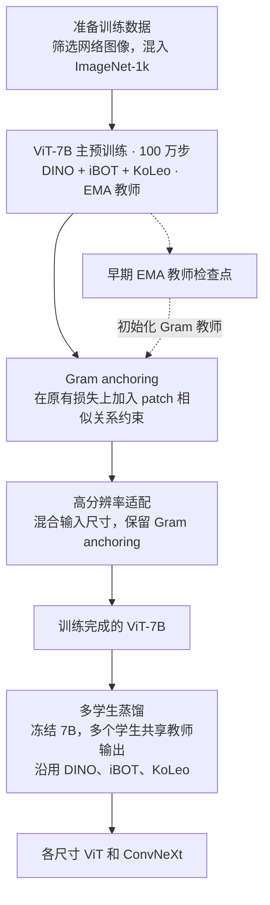

## 写在前面

[[(2025 arXiv) DINOv3|DINOv3]] 自 2025 年 8 月发布以来，似乎在计算机视觉的各个领域里取得了压倒性的优势。虽然作者团队声称其预训练数据集 —— LVD-1689M 主要来自 Instagram 的公开帖子（大多数可能是自然图像），但是笔者发现其在医学影像上的 linear probing 效果也很给力 💪！笔者尝试了 X 光（RSNA-Pneumonia 图像分类）、超声（BUSI 病灶分割）、CT（AbdomenCT-1K 3D 器官分割）和 MRI（PI-CAI 病灶检测）。这几个任务跑下来，DINOv3 都挺能打。我就这么被 DINOv3 圈粉了。索性开个系列，边读论文边记。

![[AQNSeRC9WFZk11lhl4BUzaQZh4Lj5jQ5OEVMB2iJLKoj9wSYZWhbWhuqEeEbYx6XgOSacjknkoLJNNR8YgZGaKRI.mp4]]

## 摘要

摘要先讲自监督学习（Self-Supervised Learning, SSL）为什么容易做大（因为不需要对图像进行标注），然后点明了本文关注的两种图像 —— 自然图像和航拍图像。

接着作者开始自夸。“a major milestone”（OK，我没意见），“simple yet effective”（我对有效性毫无意见，但是 DINOv3 真的 simple 吗？）。

接下来开始梳理本文的贡献：

1. **做大做强**：数据更多了，模型更大了。
2. **引入 Gram anchoring**：解决了长训后密集特征变差的问题。论文里，ImageNet 分类还在涨，VOC 分割已经开始掉分了。
3. **售后服务**：在训练完 7B 参数的怪兽之后，做了一些关于高分辨率、小模型和文本对齐的调整。

## 引言

自监督学习（SSL）是训练视觉基础模型（foundation model，简称「基模」）的一种有效方法。它直接从图像像素里找训练信号，用到的是图像里经常一起出现的模式。例如，在一张人脸照片里，眉毛、眼睛、鼻子和嘴巴通常有相对固定的位置关系。

![[Pasted image 20261113103656.png|让 ChatGPT 仿照 Darren Coffield 的 Masters of Reality 系列风格生成的一张美女图像。|320]]

拿刚才那张人脸照片来说，如果只有图，没有配文，也没人给它打过标签，能拿来训练吗？
- **全监督学习**（例如 [[(2023 ICML) Scaling Vision Transformers to 22 Billion Parameters|ViT-22B]]）得先有类别标签。
- **基于文本的弱监督学习**（例如 [[(2021 ICML) Learning Transferable Visual Models From Natural Language Supervision|CLIP]] 和 [[(2025 NeurIPS) Perception Encoder The best visual embeddings are not at the output of the network|Perception Encoder]]）用的是图文对，至少得有一段跟图搭得上的文字。
但是自监督学习没那么多 P 事儿。可以玩的花样儿很多，比如把眼睛的一小块遮住，让模型根据周围露出来的眼睫毛、眼睑部分去预测那一块的特征。这样一来，一大堆原本没有配文、也没有标签的照片，也能用来做预训练。

自监督学习的另一个优点是，它不去以优化具体任务（比如分类、分割、检测等等）作为目标（PS：还是会有代理任务，而且代理任务的好坏直接决定了自监督学习后的模型质量）。然后作者又去夸了夸前作 [[(2024 TMLR) DINOv2 Learning Robust Visual Features without Supervision|DINOv2]]，说它 linear probing 性能多强多强 blabla。接着，作者列了几个用自监督学习处理科学数据的例子，其中有四篇用到了 DINOv2。
- **组织病理学**。 [[(2024 Nature Medicine) A foundation model for clinical-grade computational pathology and rare cancers detection|Virchow]] 用 DINOv2 的训练方法，把约 150 万张病理切片切成小图来训练自己的 ViT。做癌症检测时，再把同一标本的图块特征汇总起来。
- **生物学**。 [[(2025 Scientific Reports) Self-supervision advances morphological profiling by unlocking powerful image representations|Kim et al.]] 用初代 [[(2021 ICCV) Emerging Properties in Self-Supervised Vision Transformers|DINO]]、[[(2020 ICML) A Simple Framework for Contrastive Learning of Visual Representations|SimCLR]] 和 [[(2022 CVPR) Masked Autoencoders Are Scalable Vision Learners|MAE]] 在细胞显微图像上学形态特征。
- **医学影像**。 [[(2025 Nature Machine Intelligence) Exploring scalable medical image encoders beyond text supervision|RAD-DINO]] 从预训练好的 DINOv2 ViT-B 权重出发，在胸部 X 光片上继续做自监督训练。
- **遥感**。 [[(2022 NeurIPS) SatMAE Pre-training Transformers for Temporal and Multi-Spectral Satellite Imagery|SatMAE]] ~~与 DINO 家族模型毛线关系都没有~~ 用的是 MAE，遮住一部分卫星图像再重建。 [[(2024 RSE) Very high resolution canopy height maps from RGB imagery using self-supervised vision transformer and convolutional decoder trained on aerial lidar|Tolan et al.]] 用 DINOv2 的方法在 1800 万张卫星图像上预训练编码器，再冻住它，用机载激光雷达数据训练一个预测树冠高度的解码器。
- **天文学**。 [[(2024 MNRAS) AstroCLIP A Cross-Modal Foundation Model for Galaxies|AstroCLIP]] 用改过的 DINOv2 方法训练星系图像编码器，再把图像特征和同一星系的光谱特征对齐。
- **高能粒子物理**。 [[(2022 SciPost Physics) Symmetries, safety, and self-supervision|JetCLR]] 用对比学习从模拟的粒子喷注里学特征。作者把它放这儿是为了 ~~凑数~~ 举一个自监督学习在高能粒子物理里的例子。

```ad-rem
title: 🍉 题外话：DINO 团队也玩起了版本迭代？
collapse: closed

研究完 DINOv2 和 DINOv3 的技术演进，不妨再扒一扒背后的作者团队。毕竟，模型的架构会升级，训练数据会扩容，**科研团队的阵容同样会发生变化，而且故事可能比论文还精彩。**

**🦖 第一幕：模型升级了，作者阵容也更新了**

2021 年，初代 DINO 横空出世，第一作者是 **Mathilde Caron**，背后还有 Hervé Jégou、Julien Mairal、Piotr Bojanowski、Armand Joulin 等一众计算机视觉领域的老将。

到了 2023 年的 DINOv2，三位共同一作变成了 [**Maxime Oquab**](https://scholar.google.com/citations?user=5vteYV8AAAAJ)、[**Timothée Darcet**](https://scholar.google.com/citations?user=G4qOJQEAAAAJ) 和 [**Théo Moutakanni**](https://scholar.google.com/citations?user=nN2MKGwAAAAJ)。

再到 2025 年的 DINOv3，前五位作者则换成了 [**Oriane Siméoni**](https://scholar.google.com/citations?user=PC7ELtEAAAAJ)、[**Huy V. Vo**](https://scholar.google.com/citations?user=gIf5VqUAAAAJ)、[**Maximilian Seitzer**](https://scholar.google.com/citations?user=3eo5KlIAAAAJ)、[**Federico Baldassarre**](https://scholar.google.com/citations?user=0iy5EucAAAAJ) 和 [**Maxime Oquab**](https://scholar.google.com/citations?user=5vteYV8AAAAJ)。

有趣的是，**DINOv2 和 DINOv3 的论文各有 26 位作者，但只有 12 位重合**。这阵容更新幅度，颇有一种球队换了半套首发、却依然保持争冠实力的感觉。

不过，仔细看名单就会发现，Maxime Oquab 连续两代稳居前排，[**Piotr Bojanowski**](https://scholar.google.com/citations?user=lJ_oh2EAAAAJ)、[**Hervé Jégou**](https://scholar.google.com/citations?user=1lcY2z4AAAAJ) 等资深研究者也始终在场。

看来 DINO 的秘诀不仅是 Self-Distillation，还有一套颇为成熟的「老带新」机制。

当然，论文署名顺序不能直接等同于组织地位或贡献大小，但从团队演变的角度看，确实能发现不少有意思的线索。

**🥐 第二幕：顺藤摸瓜，发现 DINO 的老家居然在巴黎**

继续扒这些作者的履历，会发现一个非常有意思的地理规律：**DINO 系列的核心研究力量长期聚集在 Meta FAIR Paris（巴黎人工智能基础研究实验室）。**

Meta 早在 [2023 年 6 月的官方文章](https://about.fb.com/news/2023/06/a-spotlight-on-the-four-emea-tech-hubs-pioneering-metas-ai-research-around-the-world/) 中就明确表示，DINOv2 是其巴黎研究团队的重要成果。FAIR Paris 实验室于 2015 年成立，还是 Meta 最重要的欧洲 AI 研究基地之一。

所以，DINO 并不是从美国搬到巴黎的，而是**这只恐龙从早期就有着浓厚的巴黎血统**。

更有意思的是，DINOv3 的第一作者 Oriane 和第二作者 Huy，其实早在 2021 年就已经合作过 [[(2021 BMVC) Localizing Objects with Self-Supervised Transformers and no Labels|LOST]]。

当时两人都与位于巴黎的 Valeo.ai（法国的一家自动驾驶公司）有研究合作关系，而且 LOST 本身就是利用初代 DINO 的自监督特征进行无标注目标定位。

也就是说，**DINOv3 的两位主力早在 DINOv2 诞生之前，就已经开始研究如何利用 DINO 的视觉表征了。**

这可不是临时组队，而是老搭档多年后在同一条技术路线上再次汇合。

更巧的是，Oriane 曾在 2022 年担任 Huy 博士答辩委员会的受邀委员之一。到了 2024 年 9 月，她正式加入 Meta FAIR 的 DINO 团队，次年便成为 DINOv3 的第一作者。

从 Valeo.ai 到 Meta FAIR，从 LOST 到 DINOv3，巴黎的自监督视觉研究圈，颇有一种「兜兜转转还是你」的感觉。

**🧀 第三幕：一封离职感言，意外曝光了 DINO 团队的日常**

DINOv3 第四作者 Federico Baldassarre 的经历尤其有意思。

他原本在瑞典 KTH 皇家理工学院读博，2023 年 9 月专门搬到巴黎，加入 Meta FAIR 的 DINO 团队做博士后。

在团队工作的两年里，他参与了 [[(2025 TMLR) Cluster and Predict Latent Patches for Improved Masked Image Modeling|CAPI]]、[[(2025 CVPR) DINOv2 Meets Text A Unified Framework for Image- and Pixel-Level Vision-Language Alignment|dino.txt]]、[[(2025 arXiv) Back to the Features DINO as a Foundation for Video World Models|DINO-world]] 和 DINOv3 等项目，研究方向从视觉表征逐渐延伸到视觉语言对齐和世界模型。

2025 年离开 Meta 时，Federico 发布了一篇信息量极大的 [LinkedIn 离职感言](https://www.linkedin.com/posts/federicobaldassarre_today-marks-my-last-day-of-postdoc-at-meta-activity-7376732469187874816-x2N-)。

这篇帖子不仅感谢了研究团队，还顺手揭开了 DINO 团队的组织架构。

他明确提到，团队的两位管理者是 **Piotr Bojanowski 和 Patrick Labatut**，并幽默地称他们为团队的 *Yin and Yang*（阴与阳）：一个更偏科学研究，一个更偏工程实践，两者形成互补。

这就很符合 DINO 系列的特点了：论文里是优雅的 Self-Supervised Learning，论文背后则是海量数据清洗、分布式训练、算力调度和工程优化。

毕竟，**想把 Vision Transformer 训练到几十亿参数，光靠优雅的数学公式可不够，还得有人负责让 GPU 不炸。**

Federico 还特别感谢了团队中的研究人员和工程师，甚至给大家起了一些非常生活化的称号：Huy 是「汤大厨」，Maximilian 是「欣赏好代码的人」，Oriane 则是他的研究讨论搭档。

最有喜感的是他们的团建活动：种玻璃生态瓶、用乐高搭埃菲尔铁塔、亲手制作奶酪板……

只能说，**白天训练 DINO，晚上研究 Cheese，科研与法式生活两手抓。**

不过，Federico 离开 Meta 后并没有告别巴黎。根据他的[个人主页](https://baldassarrefe.github.io/)，他于 2025 年 12 月加入了同样位于巴黎的 **Mistral AI**，继续研究多模态基础模型。

恐龙不养了，改去研究米斯特拉尔风（Mistral 是法国的一种风）。

**✈️ 第四幕：人才流动了，但巴黎科研朋友圈并没有散**

Federico 并不是唯一离开 Meta 的 DINO 核心成员。

初代 DINO 和 DINOv2 的重要作者 [**Armand Joulin**](https://scholar.google.com/citations?user=kRJkDakAAAAJ)，曾经是 FAIR 的资深研究负责人，2023 年离开 Meta 加入 Apple，后来又转向 Google DeepMind。

更有趣的是，**他在 Google DeepMind 的工作地点同样是巴黎**。

初代 DINO 第一作者 Mathilde Caron 也已经加入 Google DeepMind Paris。

这件事可以从 2025 年 12 月发表的 [[(2025 PLOS Computational Biology) Cell-DINO Self-supervised image-based embeddings for cell fluorescent microscopy|Cell-DINO]] 论文中得到印证：Mathilde Caron 和 Armand Joulin 的机构署名都是 Google DeepMind, Paris, France。

而且，这篇论文中还出现了 Théo Moutakanni、Camille Couprie 和 Piotr Bojanowski 等 Meta FAIR 研究者。

也就是说，即使有些人已经不在同一家公司，**他们仍然可能在同一座城市、同一个研究领域。**
```

DINOv2 已经缓解了训练不稳定和表征坍塌的问题。可真要把模型做得更大、训得更久，又冒出了三个问题。
1. **图多了，怎么挑？** 手里有一大堆没标注的图，怎么从中挑出对训练有用的？
2. **还没开练，就得先定好练多久？** 用余弦学习率调度，通常要先定总步数，好让学习率在最后一步降到预定值。可数据一多，开跑前谁知道练多少步才够？
3. **怎么练久了，分割反而掉分？** 作者在比 ViT-Large（约 3 亿参数）更大的模型上发现，训练到后期，patch 特征的相似度图越来越乱。
为了解决上述问题，DINOv3 应运而生。

### 强大的多面手

![[Pasted image 20261113134926.png]]

DINOv3 想在两件事上当个多面手：
- **一（特征）图多用。** 同一张图只过一遍骨干，提出来的特征就能给分类、分割等任务共用。各接各的任务头，骨干参数冻着，成绩也能跟专用模型掰掰手腕。
- **训练方法也能跨领域用。** 自监督预训练不依赖于 metadata，因此在网络图片和科学观测图像上都能用。
	- 图 1(d) 用的是在航拍影像上训练的 DINOv3。作者把每个 patch 的特征用 PCA 压成三个数，再当作 RGB 画出来。农田、道路、房屋都可以清晰地区分开来。

### Gram anchoring 带来的高质量特征图

![[Pasted image 20261113154124.png|DINOv3 封神图。仅通过 SSL，模型就可以分辨清楚哪些看上去像香蕉、南瓜、哈密瓜、橘子。]]

DINOv3 的自监督训练有两个目标：
- 让模型在高层语义任务上表现出色，
- 同时学出高质量的密集特征，让深度估计、3D 匹配这类几何任务拿来就能用（顶多做一点后处理）。
麻烦在于，这两个目标在优化时可能互相牵制。模型越大、训练越久，就可能出现全局表征越学越好、密集表征反而越学越差的情况。为此，作者引入了 Gram anchoring 损失来缓解密集特征的退化。

需要注意的是，为了专门计算 Gram anchoring 损失，DINOv3 引入了另外一个教师模型，其和 EMA 教师模型有所不同。

```ad-que
collapse: closed

是不是两个损失没有平衡好？Gram anchoring 数学上确实很优美，但是真的有必要吗？Anyway，作者并未在论文中报告不加 Gram anchoring、只调整 DINO 损失和 iBOT 损失所对应的实验结果。
```

### DINOv3 大家庭

![[Pasted image 20261113155547.png|DINOv3 家族的性能。]] ^1bnhkq

先用 DINOv3 的框架训练了一个 7B 模型，然后再用它去蒸馏一系列小模型：
- **ViT**：small, base, large, huge.
- **ConvNeXt**: tiny, small, base, large.
然后作者发现，ViT-Large 的性能竟然神奇地和 ViT-7B 教师性能接近？！也就是说我们普通玩家玩玩 ViT-Large 就行了，真没必要去玩 7B。

```ad-que
collapse: closed

我怎么看在 [[手撕 DINOv3 ：01 – 摘要与引言#^1bnhkq]] 中的 (a) Semantic segmentation (ADE20k) 这个图里，从左往右数第四个蓝色模型的性能相较第三个还有所（略微）衰退呢？
```

```ad-important
collapse: closed

蒸馏小模型时，作者沿用了 DINOv3 预训练里的 DINO、iBOT 和 KoLeo。区别在于：
- 出答案的老师换成了已经训好的 7B，权重固定，不进行 EMA。
- 小模型看的是完整的裁剪，iBOT 只挑一部分 patches，让它在这些位置跟老师对答案。蒸馏时没观察到 patch 特征退化，所以也没再加 Gram anchoring。
```

### 贡献总结

1. **准备数据集。** 借用 [[(2024 TMLR) Automatic Data Curation for Self-Supervised Learning A Clustering-Based Approach|Vo et al.]] 的方法，先把大量网络图片按特征分组，再从各组里均衡抽样，免得常见的内容占了大头。训练时还专门留出约 10% 的 batch，只放 ImageNet-1k 的图。
2. **模型做到 7B。** 前两代 DINO 的 ViT 用的是可学习的绝对位置编码，到了DINOv3，位置编码换成了沿横、纵两个方向计算的 RoPE，训练时还会随机缩放坐标范围，让模型更能适应不同的输入尺寸。主预训练跑了 100 万步，预热后学习率保持恒定，权重衰减和教师的 EMA 动量也固定。这样开跑前就不用先给余弦曲线定个终点。
3. **引入 Gram anchoring 来拯救密集特征。** 前面说过，模型训久了，密集表征的质量会下降。DINOv3 用训练早期的教师做参照（并定期更新），让学生对齐同一张图里各个 patch 之间的相似关系。相似度图干净了，分割这类密集任务的成绩也回来了。
4. **适应高分辨率，再让 7B 带一班学生。** 作者加了一轮高分辨率训练，又把 7B 蒸馏成一批大小不同的模型。「一师多徒」省的是教师的算力。同一批图，7B 的输出算一遍，几个学生分着用。


