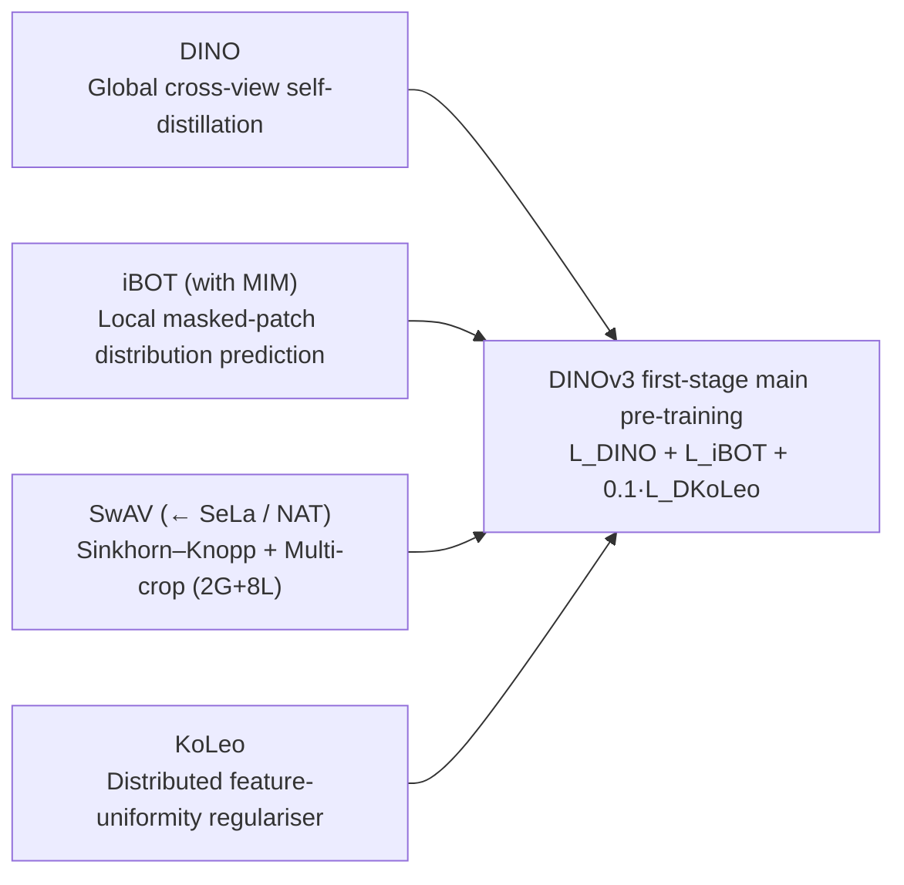

Without human labels, a model can't just sit there staring blankly at images. Self-Supervised Learning (SSL) makes its living by setting its own exam questions — designing a **pretext task** that scrounges supervision signals out of raw data for free.

In natural language processing, this is second nature: text is inherently a sequence of discrete symbols, so blank out any word or split any sentence, and the right answer is already sitting in the original. Switch to computer vision, though, and the trouble starts — images are continuous, high-dimensional pixel signals, with no ready-made vocabulary and no dictionary to classify against.

Following the references cited in Section 2, "Self-supervised learning", of the DINOv3 paper, this post traces the three main threads that earlier researchers carved out: **early visual pretext tasks → masked prediction → cross-view discrimination and self-distillation**, before landing back on the training recipe DINOv3 actually carries over.

## From language modelling to visual pretext tasks

### Where do self-supervised signals come from in natural language?

First, let's see how our neighbours in NLP pull answers out of plain text. Take a single sentence as an example: *The cat sleeps on the sofa.*

- Give the model `sleeps` and ask it to guess its neighbours: `cat` and `on` in the original sentence are ready-made answers;
- Blank out `sleeps` and ask it to fill in the gap from the left and right context: the answer is still sitting right there;
- Give it only the prefix `The cat sleeps on the` and ask it to guess the next word: the answer is, once again, written right after it.

One sentence, sliced into inputs and targets in a few different ways, gave rise to the three classic routes of NLP pre-training.

#### Word vectors | Learning representations from "birds of a feather"

- **[[(2013 NeurIPS) Distributed Representations of Words and Phrases and their Compositionality|word2vec]]** focused on polishing the Skip-gram training recipe and served up a classic trick — **negative sampling**. Take `The cat sleeps on the sofa.`: pick `sleeps` as the centre word with a window of one word on each side, and you immediately get two positive pairs from the original sentence, `(sleeps, cat)` and `(sleeps, on)`. Then, keeping `sleeps` fixed, randomly draw a few unrelated words from the vocabulary weighted by word frequency (raised to the $3/4$ power) — say `airplane` and `pencil` — to form negative pairs. During training, we pass the dot product of the centre-word and candidate-word vectors through a sigmoid to score each pair, pushing positive pairs up and negative pairs down. If the corpus also contains `The cat naps on the sofa.`, then `naps` will frequently be paired with `cat` and `on` as positives too — after churning through masses of text, `sleeps` and `naps` receive much the same gradient signals, so their vectors naturally drift closer and closer together. When training wraps up, what you're left with is a static lookup table of word vectors.
- **[[(2017 TACL) Enriching Word Vectors with Subword Information|fastText]]** keeps the Skip-gram framework, but stops treating a word as an isolated, indivisible unit. It breaks words into character fragments marked with start and end boundaries (character n-grams), so that an in-vocabulary word's representation is built by **summing the vector of the whole word itself with those of its subword fragments**. As a result, `sleep` and `sleeps` can share the weights of fragments such as `sle`, `lee` and `eep`: what common words learn can lend a hand to rare words with similar spellings, and even for an out-of-vocabulary (OOV) word never seen before, its subwords alone can still piece together a sensible vector.

#### Sentence representations | One word, many meanings — context matters

Static word vectors have an inescapable flaw: whether in "eat an apple" or "buy an Apple", `apple` looks up the exact same fixed vector. To make word representations shift with context, you have to bring in a bidirectional Transformer.

- **[[(2019 NAACL) BERT Pre-training of Deep Bidirectional Transformers for Language Understanding|BERT]]** simply turns the sentence into `The cat [MASK] on the sofa.` and has a bidirectional Transformer look at both `The cat` on the left and `on the sofa` on the right to fill in the masked `sleeps` — this is **Masked Language Modelling (MLM)**. Because attention in every layer attends to the full context, the same word finally gets different representations in different contexts. In addition, BERT prepends a `[CLS]` token to the sequence, uses it for **Next Sentence Prediction (NSP)** during pre-training, and conveniently reuses its output for sentence-level classification downstream.
- **[[(2019 arXiv) RoBERTa A Robustly Optimized BERT Pretraining Approach|RoBERTa]]** put BERT's recipe under a thorough audit. It dropped the NSP task, which had proved to be of little use, and replaced the static masking baked in during data preprocessing with **dynamic masking** — each time the same sentence comes round in a new epoch, it might mask `sleeps` one time and `sofa` the next. Throw in more data, bigger batches and longer training, and it proved outright that without changing a single line of the model architecture, dialling in the pre-training recipe alone delivers a huge jump in performance.

#### Language models | No peeking ahead — just guess the next word

- **[[(2010 Interspeech) Recurrent Neural Network Based Language Model|RNN LM]]** takes a purely autoregressive route: a recurrent neural network reads the sentence word by word from left to right. With each new word, it refreshes its memory by combining it with the previous step's hidden state, then outputs a probability distribution over the vocabulary for the next word. By the time it reaches `The cat sleeps on the`, how highly the model scores `sofa` depends solely on the context it has already seen; as the prediction window slides right, every position in the sentence provides a free supervision signal.
- **[[(2014 arXiv) Recurrent Neural Network Regularization|Zaremba et al.]]** also works on next-word prediction, zeroing in on a sore spot of training deep LSTMs at the time: **where exactly should dropout go?** Apply dropout carelessly to the recurrent connections, and over long sequences the long-range memory the model has built up is easily wiped out at random. The authors' solution is remarkably restrained — apply dropout only to the **non-recurrent connections** (for example, between the layers of a stacked LSTM), while leaving the state passed across time steps within the same layer untouched. That wards off overfitting while keeping memory intact.

### Setting exam questions for images too

With text, you can mask out words or predict them one by one, but in the pre-ViT era, when CNNs did all the heavy lifting, images had neither a ready-made discrete vocabulary nor a time axis along which to guess one word at a time. To coax semantic visual features out of the network, early visual self-supervision researchers dreamed up an assortment of "image brain-teasers" for CNNs:

- **[[(2015 ICCV) Unsupervised Visual Representation Learning by Context Prediction|Context Prediction]]** plays a game of "which direction?". It crops two non-adjacent patches from the same image, extracts features from each with a shared-weight CNN, and predicts where the second patch sits relative to the first — the eight directions (➡️, ↗️, ⬆️, ↖️, ⬅️, ↙️, ⬇️, ↘️) naturally form an 8-way classification task. Interestingly, neural networks are brilliant at finding loopholes: at first it actually cheated its way to high scores by peeking at lens chromatic aberration and edge-pixel continuity, forcing the authors to add random position jitter and colour-channel dropping to plug the loophole.
- **[[(2016 ECCV) Unsupervised Learning of Visual Representations by Solving Jigsaw Puzzles|CFN]]** ups the ante to a "nine-tile jigsaw". The authors propose the Context-Free Network, which slices an image into a $3\times 3$ grid and shuffles it; a shared-weight CNN first extracts features from each of the 9 tiles independently (so they can't chat with one another early on), before concatenating them to guess which permutation was applied. Of course, nobody could cope with treating all $9! = 362{,}880$ permutations as classes, so the paper picks a fixed subset in advance by maximising Hamming distance (for example, 100 permutations) to serve as the classification labels.
- **[[(2020 CVPR) Self-Supervised Learning of Pretext-Invariant Representations|PIRL]]** also slices the image into a shuffled nine-tile grid and extracts per-tile features with a shared-weight CNN before concatenating them, yet it put its finger on a sharp flaw: CFN forces the model to remember "how the tiles were shuffled" (learning features that are **covariant** with the transformation), whereas downstream image recognition couldn't care less how you solve the jigsaw, and instead needs features that stay **invariant** to local shuffling. So PIRL stops predicting the permutation index; instead, it treats jigsaw shuffling as a data augmentation and uses contrastive learning to pull the representations of the original and shuffled images closer together. With that pivot, it already had one foot in the coming era of cross-view contrastive learning.
- **[[(2016 CVPR) Context Encoders Feature Learning by Inpainting|Context Encoders]]** takes the "fill-in-the-blank" intuition straight to pixels: cut a chunk out of the image and have an encoder–decoder inspect the surrounding context to reconstruct the missing pixels. A pure L2 pixel-reconstruction loss preserves the rough geometry, but the filled-in region always looks as if viewed through frosted glass; the authors therefore add an adversarial loss, which not only makes the inpainted result sharper and more realistic, but also yields more solid visual representations downstream.
- **[[(2016 ECCV) Colorful Image Colorization|Colorful Image Colorization]]** puts the model to work "colouring in black-and-white photos": it takes a greyscale image as input (the L channel of the Lab colour space) and predicts the missing colour information (the a and b channels). To stop direct MSE regression from averaging a colourful world into a safe, muddy grey-brown soup, the authors discretise the continuous colour space into 313 colour bins as a classification task, and apply class rebalancing to upweight rare, vivid colours — forcing the model to recognise "this is grass, so paint it green; this is a school bus, so paint it yellow".
- **[[(2018 ICLR) Unsupervised Representation Learning by Predicting Image Rotations|RotNet]]** is perhaps the most brutally simple — yet surprisingly effective — pretext task: rotate the whole image clockwise by 0°, 90°, 180° or 270°, and have the CNN guess how far it was turned. The rotation angle itself is a ready-made 4-way classification label — to get it right, the model at least has to recognise that a dog's feet belong at the bottom and the sky belongs overhead.

Looking back at these early pretext tasks, the ideas are clever, yet they all suffer from the limitations of "hand-set questions" — the learned features are easily led astray by the biases of the pretext task itself. It wasn't until a few years later, when ViT arrived with its patch-sequence architecture, that the once rather clunky "hole-filling" (inpainting) suddenly got a new lease of life, sparking the masked image modelling boom of the next section.

## Mask out part of an image — what exactly should the model predict?

ViT slices an image into a sequence of patches, structurally almost identical to a sequence of text tokens. A natural question follows: could we mask out some of those patches, just as BERT does, and have the model play "fill-in-the-blank" directly on unlabelled images?

The idea is straightforward, yet putting it into practice immediately hits an unavoidable question: **what exactly should the prediction target for the masked region look like?**

Text is naturally discrete: mask a word and you simply classify over the vocabulary. An image, however, is a continuous physical signal, and there are all sorts of ways to formulate the target. Around the question of "what exactly to predict", **Masked Image Modelling (MIM)** gradually split into three paths.

### School 1: Tackle pixels head-on (pixel space)

The most naive idea, of course, is simply to paint back whatever was masked out.

- **[[(2022 CVPR) Masked Autoencoders Are Scalable Vision Learners|MAE]]** distils this idea to its purest simplicity: randomly mask about 75% of the patches and let the encoder process only the visible 25% (slashing compute and memory consumption); finally, a lightweight decoder inserts the mask tokens and reconstructs the original pixels at the masked positions using **mean squared error (MSE)**. This "heavy encoder, light decoder" pairing excels at providing a strong weight initialisation for downstream fine-tuning, but its drawback is just as clear: the model spends plenty of capacity memorising high-frequency details such as background textures, so when the backbone is frozen for linear probing, its semantic representations often trail contrastive or self-distillation methods — not quite aligned with the DINO family's goal of "freeze the backbone — one image, many uses".

### School 2: Force discretisation and pretend images are text (discrete visual tokens)

Since BERT's success leaned on a vocabulary, why not build a "visual dictionary" for images?

- **[[(2022 ICLR) BEiT BERT Pre-Training of Image Transformers|BEiT]]** does just that: it first brings in a discrete VAE (dVAE) trained for [[(2021 ICML) Zero-Shot Text-to-Image Generation|DALL-E]] to translate the original image into a sequence of discrete visual token IDs; it then feeds the full patch sequence, complete with mask tokens, into a ViT and trains it with cross-entropy to predict the token IDs at the masked positions. And just like that, CV had lifted the entire NLP playbook.
- **[[(2021 arXiv) Are Large-scale Datasets Necessary for Self-Supervised Pre-training|SplitMask]]** builds on BEiT to ask a further question: **does self-supervised pre-training really require a massive dataset like ImageNet?** It splits an image's patches into two complementary sets, asks each side to predict the other's discrete visual tokens, and uses an InfoNCE contrastive loss to pull the two resulting whole-image representations together. This "left hand sparring with the right" proved remarkably tough: even when pre-trained straight on the downstream task's own small dataset, it still turns in very respectable results.

### School 3: Give up on pixels and head for latent space (latent space and the JEPA universe)

Both predicting raw pixels and relying on an external dVAE for discretisation feel a bit roundabout — after all, humans looking at a picture don't memorise every pixel's RGB value, nor do they flick through a dictionary in their heads. So a more mainstream shift took hold: **simply predict directly in a continuous, high-level feature space.**

- **[[(2022 ICML) data2vec A General Framework for Self-supervised Learning in Speech, Vision and Language|data2vec]]** spans three modalities — images, speech and text — within a single framework. It adopts a teacher–student setup: the teacher network sees the full input and averages the normalised features from its top few layers to form a continuous prediction target; the student network sees only the masked input alongside learnable mask tokens, and regresses onto the teacher's features at the corresponding positions. To stop teacher and student sliding into **representation collapse** together, the teacher's weights are updated slowly via an exponential moving average (EMA) of the student's weights.
- **[[(2023 ICML) Efficient Self-supervised Learning with Contextualized Target Representations for Vision, Speech and Language|data2vec 2.0]]** is the upgrade that maxes out training efficiency. In each iteration, the teacher computes target features for a sample just once and shares them across several different masked versions (multi-mask) trained together; at the same time, borrowing MAE's trick, it kicks the mask tokens out of the student encoder so the encoder processes only the visible portion, tacking on a lightweight convolutional decoder at the back end to fill in the missing features and dramatically speeding up training.

Around the same time, Yann LeCun laid out a systematic conceptual framework for this line of thinking in his [long roadmap paper](https://openreview.net/pdf?id=BZ5a1r-kVsf), formally proposing **[[(2022 OpenReview) A Path Towards Autonomous Machine Intelligence|JEPA]]** (Joint-Embedding Predictive Architecture). JEPA's core idea is refreshingly clear-headed: encode the context and the target separately into an abstract representation space, then predict the target's representation from the context's. That way, the model can discard, with a clear conscience, unpredictable low-level pixel noise (such as leaves rustling at random) and save its compute and capacity for predictable high-level semantics.

Judged by JEPA's architectural criteria, the DINOv3 paper broadly groups both the data2vec series and I-JEPA under the JEPA paradigm. Strictly speaking, though, if you scrutinise the architectural details, the original data2vec feeds mask tokens straight into the student encoder — effectively making the encoder moonlight as the predictor — whereas **data2vec 2.0 cleanly decouples the encoder (which sees only the visible input) from the decoder (which brings in mask tokens to predict), finally taking on the true structural shape of a standard JEPA**.

Following this blueprint, Meta's JEPA family evolved all the way from images to video and planning:

- **[[(2023 CVPR) Self-Supervised Learning from Images with a Joint-Embedding Predictive Architecture|I-JEPA]]** is the first realisation of this idea on images. It first carves out several large block-shaped target regions (target blocks) from the image and removes them from a large context block, leaving the encoder to see only the remaining visible context; the predictor then uses the positional information of those target blocks to regress onto the corresponding target features extracted by the EMA teacher from the complete image.
- **[[(2024 TMLR) Revisiting Feature Prediction for Learning Visual Representations from Video|V-JEPA]]** carries this playbook over to video, masking blocks directly on the spatio-temporal token grid. Once again, the encoder sees the visible video tokens while the predictor regresses onto the features computed by the EMA teacher from the full video clip, forcing the model to learn how objects move over time.
- **[[(2025 arXiv) V-JEPA 2 Self-Supervised Video Models Enable Understanding, Prediction and Planning|V-JEPA 2]]** scales up both data and model size while sticking to the same clean recipe of masked feature prediction. More interestingly, the team also post-trained an action-conditioned variant, **V-JEPA 2-AC**, on robot trajectory data — hand it the current view and a candidate action, and it rolls out the resulting future state in representation space, which can be used directly for robot planning. The "world model" LeCun had been banging on about for years was finally in motion.

## From instance discrimination to cross-view matching

The "fill-in-the-blank" paradigm of the previous section performs local reconstruction inside a single image; another lineage, closer to DINOv3's own bloodline, is **discriminative self-supervised learning (discriminative SSL)**. Its underlying intuition couldn't be simpler: however you randomly crop or recolour an image, at heart it is still "itself".

Pair up different views of the same image and pull them closer, and you have a supervision signal. In practice, though, methods like this can never sidestep two core questions: **what space should views from the same source be aligned into? And how do you stop the neural network from taking the lazy way out and outputting the same constant vector for every image (that is, representation collapse)?**

Wrestling with these two questions, the CV community moved through three stages.

### Stage 1: Everything gets a class of its own (instance discrimination)

The most direct way to stave off collapse is blunt: with no human labels, **treat each image as its own independent class**.

- **[[(2006 CVPR) Dimensionality Reduction by Learning an Invariant Mapping|DrLIM]]** is an early ancestor of this line of work. It encodes a pair of samples with a shared-weight Siamese network and uses a **contrastive loss** to pull together "similar pairs" defined by prior knowledge, while penalising "dissimilar pairs" whose distance hasn't yet been pushed beyond a safety margin. Here, similar pairs do not depend on human class labels; they come from prior neighbourhood relations — such as local nearest neighbours in input space, or **different views of the same object under translation, slight shifts in viewpoint or lighting changes** (yielding the invariant mapping of the paper's title). This pairwise metric learning directly laid the groundwork for visual contrastive learning more than a decade later.
- **[[(2016 TPAMI) Discriminative Unsupervised Feature Learning with Exemplar Convolutional Neural Networks|Exemplar-CNN]]** goes straight for brute-force classification: it samples a set of seed patches from unlabelled images, numbers each one, and applies all manner of random data augmentations (translation, scaling, rotation, colour adjustments and the like). Every variant derived from the same patch gets the same "surrogate class" label, and the CNN is trained to recognise which seed patch an input originally came from — forcing the model to ignore augmentation noise and learn transformation-invariant instance representations.
- **[[(2017 ICML) Unsupervised Learning by Predicting Noise|NAT]]** (Noise As Targets) has a very clever idea: to ditch Exemplar-CNN's enormous classification head, with its hundreds of thousands of classes, it first scatters a set of fixed random vectors uniformly over a low-dimensional unit hypersphere as "targets" (one per image) and trains the network to regress onto them directly. Note, however, that **each image is not permanently glued to a random target from the start** — otherwise the network would merely be memorising random noise. NAT uses alternating optimisation: first, with the network fixed, it dynamically assigns each image the target **closest** to its current feature under a strict "one-to-one, no collisions" constraint; then, with the assignments fixed, it pulls the network's output closer to its assigned target. By "grabbing the nearest ticket", similar images naturally cluster in neighbouring regions of the sphere; by "one seat per person", all the features are forced to spread evenly across the sphere to prevent collapse — somehow coaxing meaningful visual representations out of a pile of pure noise.
	```ad-rem
	title: 🍉 Easter egg: NAT and K-means
	collapse: closed
	If you caught a faint whiff of a souped-up K-means while reading this, your intuition is scarily accurate — NAT is essentially an extreme version of K-means that cranks the number of clusters all the way up to $K=N$, welds the cluster centres in place (forcing the data features to adapt to the centres), and strictly enforces a "one-to-one balanced assignment". More interestingly, NAT's authors, Bojanowski and Joulin, are the very same original FAIR Paris crew who served up [[(2018 ECCV) Deep Clustering for Unsupervised Learning of Visual Features|DeepCluster]] the following year: in DeepCluster they shrank $K$ back to far below $N$ and let the centres update, only to spend ages fighting empty clusters; then in [[(2020 NeurIPS) Unsupervised Learning of Visual Features by Contrasting Cluster Assignments|SwAV]], they brought NAT's old "balanced assignment" gene back with Sinkhorn–Knopp. Eight years on, after coming full circle, Piotr Bojanowski is still the last author on DINOv3 — the people and ideas of the SSL world keep coming back around, and sometimes it really is more gripping than a TV drama.
	```
- **[[(2018 CVPR) Unsupervised Feature Learning via Non-Parametric Instance Discrimination|NPID]]** pushes "one image, one class" closer to modern contrastive learning: it does away with the parametric classification head altogether and simply maintains a memory bank storing the instance features of all training samples as references. During training, each view's feature is pulled towards its "archived copy" in the bank and pushed away from every other instance.

### Stage 2: The negative-sample arms race, ditching negatives and explicit statistical regularisation

Between 2019 and 2022, cross-view matching exploded, splitting into three camps over how to prevent collapse efficiently.

**First, the "brute-force negatives" camp**: pile on enough negatives and the model won't get away with collapsing.

- **[[(2020 ICML) Data-Efficient Image Recognition with Contrastive Predictive Coding|CPC v2]]** still takes the "patch-level spatial contrast" route, quite different from MoCo and SimCLR's later approach of contrasting augmented views of whole images. It first slices the image into a grid of overlapping patches and encodes each one, then uses a masked context network to aggregate local information (upgraded in v2 to all four directions: up, down, left and right) to predict the patch feature at a target location several steps away. The positive sample is the real patch feature at that target position in the same image, while the negatives combine patch features from other positions in the same image and from other images in the same batch; training uses the InfoNCE loss so that the prediction scores the "true match" above all the "bystander patches". By switching to LayerNorm (to stop BN leaking answers across patches), upgrading the encoder and adding patch-level data augmentation, CPC v2 was also the first to show that in low-label settings, self-supervision can overtake pure supervision on data efficiency.
- **[[(2020 CVPR) Momentum Contrast for Unsupervised Visual Representation Learning|MoCo]]** solves the headache of "wanting masses of negatives without blowing up GPU memory". It treats two augmented views of the same image as a positive pair, feeding them into a query encoder and a momentum key encoder respectively; meanwhile, it maintains a dynamic queue across batches to stockpile huge numbers of negatives, updating the key encoder slowly with EMA so that older features in the queue don't go stale too fast.
- **[[(2020 ICML) A Simple Framework for Contrastive Learning of Visual Representations|SimCLR]]** is classic Google style: no queue; two augmented views of the same image form the positive pair, and the views of every other image in the current, massive batch serve as negatives. How massive? At the time, mainstream setups (including MoCo next door) still generally used a batch size of **256**, which a lab's 8-GPU machine could handle, whereas SimCLR — sitting on its own TPU goldmine — cranked the batch size straight up to **4096 or even 8192**, a full **16 to 32 times** larger (packing over ten thousand negatives into a single batch, and having to wheel out the LARS optimiser to keep training stable). Bolt a non-linear MLP projection head onto the encoder and apply a temperature-scaled contrastive loss, and it traded compute for minimalism to stunning effect.

**Next came the "no-negatives rebels"**: people began asking whether it was really worth maintaining a mountain of negatives just to prevent collapse.

- **[[(2020 NeurIPS) Bootstrap Your Own Latent A New Approach to Self-Supervised Learning|BYOL]]** doesn't use a single negative sample, training purely on two positive views of the same image. Its online branch encodes, projects and predicts in turn, aiming to match the target branch's projection of the other view; the target branch takes no gradients and only slowly tracks the online branch's parameters via EMA. That this seemingly "pulling yourself up by your own bootstraps" trick somehow didn't collapse left the entire community stunned at the time.
- **[[(2021 CVPR) Exploring Simple Siamese Representation Learning|SimSiam]]** followed straight on with a minimalist "teardown" of BYOL: no negatives, no huge batches, and even the EMA momentum encoder stripped out. Both augmented views share the same encoder; one side gets a prediction head, the other gets stop-gradient, and once the symmetric negative cosine similarity is computed, you're done. It hit the nail on the head: the secret to avoiding collapse lies in the asymmetric dynamics of `predictor + stop-gradient`.

**Finally, the "statistical regularisation" camp**: rather than relying on implicit architectural dynamics to prevent collapse, why not write the anti-collapse conditions straight into the loss function?

- **[[(2022 ICLR) VICReg Variance-Invariance-Covariance Regularization for Self-Supervised Learning|VICReg]]** puts it bluntly: alongside pulling together representations of views from the same image (Invariance), it adds two extra constraints — penalising feature dimensions whose standard deviation drops below a threshold (Variance, forcing samples apart) and penalising covariance across dimensions (Covariance, stopping multiple channels from learning redundant duplicates). Clean, decisive, pure maths.

### Stage 3: From cluster assignments all the way to DINO and iBOT

Obsessing over individual instances always felt a bit short-sighted — two different cat photos plainly look much the same, yet contrastive learning insists on treating them as negatives and shoving them as far apart as possible. So the Meta (FAIR) lineage pivoted to **self-clustering**, which ultimately supplied the direct DNA of the DINO family:

- **[[(2018 ECCV) Deep Clustering for Unsupervised Learning of Visual Features|DeepCluster]]** pioneered "offline clustering + pseudo-labels": run K-means over the features of all images and use the cluster indices as pseudo-labels to train the CNN; once the network updates, re-extract features, re-cluster, and iterate back and forth.
- **[[(2020 ICLR) Self-labelling via simultaneous clustering and representation learning|SeLa]]** tackles the collapse problem clustering fears most: "everyone piling into the same cluster". It unifies pseudo-label assignment and representation learning in a single optimisation framework, introducing the **Sinkhorn–Knopp** algorithm to enforce a balance constraint (so each cluster receives roughly the same number of samples).
- **[[(2020 NeurIPS) Unsupervised Learning of Visual Features by Contrasting Cluster Assignments|SwAV]]** left behind the cumbersome ritual of offline full-dataset clustering and ushered in online clustering: it assigns one view's features evenly to a set of learnable prototypes via Sinkhorn–Knopp, then asks another view of the same image to predict that assignment (swapped prediction). Incidentally, SwAV also introduced the multi-crop strategy — which, alongside Sinkhorn–Knopp, became standard kit in DINOv2 and DINOv3.
- **[[(2021 ICCV) Emerging Properties in Self-Supervised Vision Transformers|DINO]]** formally brought this thinking onto the ViT stage, rolling out "self-distillation with no labels". Its EMA teacher sees only global crops, while the student, looking at other global or local crops of the same image, tries to match the teacher's outputs; both sides project the `[CLS]` token into a probability distribution, and the student fits the teacher via cross-entropy. To prevent collapse, the teacher side cleverly pairs centering (to stop any one dimension dominating) with sharpening (to stop it slumping into a uniform distribution). Not only did it post eye-catching evaluation scores, but remarkably crisp object outlines also emerged spontaneously in the ViT's attention maps.
- **[[(2022 ICLR) iBOT Image BERT Pre-Training with Online Tokenizer|iBOT]]** slotted in the final piece of the puzzle — welding discriminative self-distillation to the masked image modelling (MIM) of the previous section. On the one hand it keeps cross-view `[CLS]` self-distillation; on the other it adds a patch-level training signal: the student sees a crop with some patches masked out, while the teacher sees the unmasked version of the same crop, and at the masked positions the student uses cross-entropy to match the teacher's patch probability distributions. That way, the EMA teacher — evolving in lockstep with training — acts directly as an "online visual tokeniser", doing away with BEiT's clunky external dVAE.

Lay out the dozen or so discriminative SSL papers above, and their anti-collapse solutions really boil down to four main schools:

| Anti-collapse school | Core mechanism | Representative work | Main cost / limitation |
| --- | --- | --- | --- |
| Negative-sample contrast | Pushes different images apart using large numbers of negatives | NPID, CPC v2, MoCo, SimCLR | Relies on large batches or queues, and easily penalises different images of the same class as false negatives |
| Asymmetric architecture + stop-gradient | Prediction head + stop-gradient (± EMA) breaks the symmetric solution | BYOL, SimSiam | Anti-collapse mechanism is rather implicit and sensitive to optimiser and architectural details |
| Explicit statistical regularisation | Directly constrains variance and covariance to prevent constant solutions and dimensional redundancy | VICReg | Requires careful tuning of the weights across multiple loss terms |
| Balanced clustering / self-distillation | Sinkhorn–Knopp or centering + sharpening stabilises the target distribution | SeLa, SwAV, DINO, iBOT | Still runs into training instability and dense-feature degradation when scaled to very large ViTs |

## Back to DINOv3: the pitfalls others fell into, and the parts they left behind

At the end of the "Self-supervised learning" section of the DINOv3 paper, the authors wrap up by simply dropping in two references — one explaining "where the goods get inspected", the other pointing out "where things go off the rails":

- **[[(2015 IJCV) ImageNet Large Scale Visual Recognition Challenge|ImageNet]]** (the ILSVRC overview) systematically lays out the data and evaluation benchmarks of the ImageNet Large Scale Visual Recognition Challenge. Naming it here effectively sets a single "common exam hall" for every SSL contender above: whether you've been solving jigsaws, filling in pixels or doing cross-view self-distillation, once you've honed your craft you still have to turn up at ImageNet and post a score to prove your learned representations actually hold up.
- **[[(2021 ICCV) An Empirical Study of Training Self-Supervised Vision Transformers|MoCo v3]]** is a diagnostic report sent specifically to pour cold water on scaling up ViTs. The authors ported four major families — **MoCo v3, SimCLR, BYOL and SwAV** — onto ViTs one by one and found a troubling pattern: self-supervision that ran smoothly on CNNs developed an "irregular heartbeat" once moved to ViTs, especially at larger model sizes. Training didn't seem to collapse outright, yet subtle gradient jitter quietly dragged down final accuracy. With a touch of alchemy about it, the authors found that simply **freezing the randomly initialised patch projection layer** noticeably eased this oscillation. That also spells out the subtext of DINOv3 citing it here: **SSL at standard scales has already been squeezed dry; once you try to scale up to truly massive models, the real slog has only just begun.**

Turn to Section 3.2 of DINOv3, and all the technical threads laid out above finally converge:

DINOv3's first-stage pre-training carries over the core recipe polished to maturity in DINOv2 — the **DINO loss** ($\mathcal{L}_{\mathrm{DINO}}$) handles the global level, aligning whole-image representations across views; the **iBOT loss** ($\mathcal{L}_{\mathrm{iBOT}}$) handles the local level, predicting latent-space distributions for masked patches (patch-level self-distillation). Neither of **SwAV**'s two heirlooms is left behind: across both objectives, **Sinkhorn–Knopp** replaces the original DINO's centering to produce balanced teacher target distributions, and its multi-view **multi-crop** strategy (2 global crops + 8 local crops) stays on board too. On top of that, it adds a distributed **[[(2019 ICLR) Spreading Vectors for Similarity Search|KoLeo]] regulariser** ($0.1 \cdot \mathcal{L}_{\mathrm{DKoLeo}}$) to spread features as evenly as possible across the space, and equips the two losses with separate projection heads and separate LayerNorms to keep training steady.



Every component looks like an old friend — yet if you cram this familiar cast straight into a 7-billion-parameter behemoth and hammer it for 1 million steps, will it really avoid collapsing or degrading? For that, read on to the next post: how exactly did the road to scaling up vision foundation models unfold?
