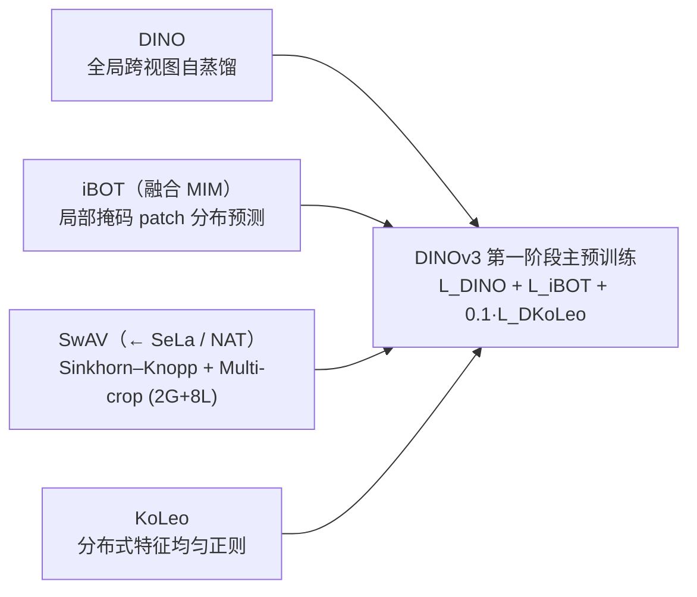

没有人工标注，模型总不能对着图片干瞪眼。自监督学习（Self-Supervised Learning, SSL）的立身之本，就是自己给自己出题——设计一个**代理任务（pretext task）**，从原始数据里白嫖监督信号。

这件事在自然语言处理里顺理成章：文本天生是离散的符号序列，随便挖个词、切个句，标准答案就写在原句里。换到计算机视觉，麻烦就来了——图像是连续的高维像素信号，既没有现成的词表，也没法直接拿字典做分类。

这一篇顺着 DINOv3 论文第 2 节「自监督学习」引用的文献清单，把前人摸索出的三条主线串一遍：**早期视觉代理任务 → 掩码预测 → 跨视图判别与自蒸馏**，最后落回 DINOv3 实际沿用的训练配方。

## 从语言建模到视觉代理任务

### 自然语言里的自监督信号从哪来？

先看隔壁 NLP 是怎么从纯文本里找答案的。就拿同一句话举例：*The cat sleeps on the sofa.*

- 给模型一个 `sleeps`，让它猜周围邻居是谁，原句里的 `cat` 和 `on` 现成就能当答案；
- 把 `sleeps` 盖住，让它结合左右文填空，答案还是现成的；
- 只给前文 `The cat sleeps on the`，让它猜下一个词，答案照样写在后面。

同一句话，换几种方式切分输入和目标，就衍生出了 NLP 预训练的三条经典路线。

#### 词向量｜从「物以类聚」里学表征

- **[[(2013 NeurIPS) Distributed Representations of Words and Phrases and their Compositionality|word2vec]]** 重点打磨了 Skip-gram 的训练配方，端出了经典技巧——**负采样（negative sampling）**。拿 `The cat sleeps on the sofa.` 来说，选中 `sleeps` 当中心词、窗口设为左右各 1 个词，就能顺手从原句抠出两组正例 `(sleeps, cat)` 和 `(sleeps, on)`；接着固定 `sleeps`，按词频加权（词频的 $3/4$ 次方）从词表里随机抓几个不相干的词（比如 `airplane` 和 `pencil`）凑成负例。训练时拿中心词向量和候选词向量的点积过 sigmoid 打分，把正例往高了推、负例往低了压。如果语料里还有一句 `The cat naps on the sofa.`，`naps` 也会频繁跟 `cat`、`on` 绑定成正例——海量文本刷下来，`sleeps` 和 `naps` 吃到的梯度信号几乎一样，向量自然越靠越近。训完收工，留下来的就是一张静态词向量查表。
- **[[(2017 TACL) Enriching Word Vectors with Subword Information|fastText]]** 保留了 Skip-gram 框架，但不把单词当成孤立的最小单元。它把单词拆成带首尾边界的字符片段（character n-grams），让词表内单词的表征由**整词自身连同这些子词片段的向量求和**拼出来。于是 `sleep` 和 `sleeps` 就能共享 `sle`、`lee`、`eep` 等片段的权重：常见词学到的信息可以帮扶拼写相近的罕见词，遇到词表里压根没见过的生词（OOV），单靠拆出的子词照样能拼出一个靠谱的向量。

#### 句子表征｜一词多义，得看语境

静态词向量有个绕不开的硬伤：不管是在「eat an apple」还是「buy an Apple」里，`apple` 查出来的都是同一个死向量。要想让词表征随语境变化，还得靠双向 Transformer 上场。

- **[[(2019 NAACL) BERT Pre-training of Deep Bidirectional Transformers for Language Understanding|BERT]]** 直接把句子变成 `The cat [MASK] on the sofa.`，让双向 Transformer 同时看左侧 `The cat` 和右侧 `on the sofa`，把遮住的 `sleeps` 填回来——这就是**掩码语言建模（Masked Language Modeling, MLM）**。因为每一层注意力都在全局看上下文，同一个词在不同语境下终于有了不同的表征。此外，BERT 还在序列开头塞了个 `[CLS]` token，预训练时拿它做**下一句预测（Next Sentence Prediction, NSP）**，到了下游则顺手拿它的输出做句子级分类。
- **[[(2019 arXiv) RoBERTa A Robustly Optimized BERT Pretraining Approach|RoBERTa]]** 则是对 BERT 配方来了一场彻底的复盘。它砍掉了被证明用处不大的 NSP 任务，把原本数据预处理时就写死的静态遮蔽改成**动态遮蔽（dynamic masking）**——同一句话在不同 epoch 再见面，上次遮 `sleeps`，这次可能就改遮 `sofa`；再叠加更多数据、更大 batch 和更长训练周期，直接证明了：模型架构一行不改，光把预训练配方调到位，性能就能涨一大截。

#### 语言模型｜不看下文，只猜下一个词

- **[[(2010 Interspeech) Recurrent Neural Network Based Language Model|RNN LM]]** 走的是纯粹的自回归路线：循环神经网络从左往右逐词读句子，每读进一个词，就结合上一步的隐藏状态刷新记忆，再输出词表上关于下一个词的概率分布。读到 `The cat sleeps on the` 时，模型给 `sofa` 打几分，全凭已经看过的上文；预测窗口一路往右滑，句子的每一个位置都在免费提供监督信号。
- **[[(2014 arXiv) Recurrent Neural Network Regularization|Zaremba et al.]]** 同样围绕下一个词预测做文章，精准切中了当年训练深层 LSTM 的痛点：**dropout 到底该加在哪儿？** 如果往循环连接上乱加 dropout，时间步一长，模型攒下来的长程记忆很容易被随机抹掉。作者的解法非常克制——只在**非循环连接**（比如堆叠 LSTM 的层与层之间）施加 dropout，而同一层内跨时间步的状态传递保持原样，既防住了过拟合，又保住了记忆力。

### 图像里也能出题

文本可以按词填空、逐词续写，但在还没有 ViT、清一色用 CNN 扛大梁的年代，图像既没有现成的离散词表，也没法顺着时间轴一个词一个词往后猜。为了逼出有语义的视觉特征，早期视觉自监督研究者给 CNN 设计了一批形态各异的「图像脑筋急转弯」：

- **[[(2015 ICCV) Unsupervised Visual Representation Learning by Context Prediction|Context Prediction]]** 玩起了「找方位」。它从同一张图里抠出两个不相接的 patch，让共享权重的 CNN 分别提特征，再猜第二块在第一块的哪个方向——八个方位（➡️、↗️、⬆️、↖️、⬅️、↙️、⬇️、↘️）天然构成 8 分类任务。有意思的是，神经网络很会钻空子，一开始竟然靠偷看镜头色差（chromatic aberration）和边缘像素连续性作弊拿高分，逼得作者不得不加上随机位置抖动（jitter）和颜色通道丢弃，才算堵住漏洞。
- **[[(2016 ECCV) Unsupervised Learning of Visual Representations by Solving Jigsaw Puzzles|CFN]]** 把难度升级成了「九宫格拼图」。作者提出 Context-Free Network，把图像切成一个 $3\times 3$ 的网格并打乱，先用共享权重的 CNN 各自独立提取 9 块的特征（保证早期互不串门），再拼到一起猜这次用了哪种排列。当然，$9! = 362{,}880$ 种全排列全当类别谁也扛不住，所以论文按最大汉明距离提前挑了一个固定子集（比如 100 种排列）来当分类标签。
- **[[(2020 CVPR) Self-Supervised Learning of Pretext-Invariant Representations|PIRL]]** 同样把图像切成九宫格打乱、同样用共享权重的 CNN 分别提特征再拼接，但它敏锐地意识到一个问题：CFN 逼着模型去记住「图块是怎么打乱的」（学出对变换**协变**的特征），可下游图像识别根本不在乎你怎么拼图，反而需要特征对局部打乱保持**不变性（invariance）**。于是 PIRL 不再预测排列编号，而是直接把拼图打乱当成一种数据增强，借对比学习拉近原图和打乱图之间的表征距离。这一转弯，其实已经一只脚跨进了后来的跨视图对比学习时代。
- **[[(2016 CVPR) Context Encoders Feature Learning by Inpainting|Context Encoders]]** 把「完形填空」的直觉直接搬到了像素上：在图里挖掉一块，让编码器-解码器盯着周围的上下文把缺失像素补出来。纯用 L2 像素重建损失能保住大致的几何结构，但补出来总像蒙了层磨砂玻璃；因此论文进一步引入对抗损失（adversarial loss），不仅让修补画面更锐利逼真，连带学出来的视觉表征在下游任务上也更扎实。
- **[[(2016 ECCV) Colorful Image Colorization|Colorful Image Colorization]]** 让模型干起了「黑白照片上色」的活：输入灰度图（Lab 色彩空间的 L 通道），预测缺失的色彩信息（a、b 通道）。为了防止直接用 MSE 回归把五彩斑斓的世界平均成一片发灰发棕的「安全泥汤」，作者把连续色彩空间离散化成了 313 个色块类别做分类，还通过类别重加权拉高罕见鲜艳颜色的权重，逼着模型必须认出「这是草地得涂绿、这是校车得涂黄」。
- **[[(2018 ICLR) Unsupervised Representation Learning by Predicting Image Rotations|RotNet]]** 可能是最简单粗暴却又出奇好使的代理任务：把整张图顺时针转 0°、90°、180° 或 270°，让 CNN 猜转了多少度。旋转角度本身就是现成的 4 分类标签——模型要想猜对，至少得先认出狗的脚该朝下、天空该在头顶。

回头看这些早期代理任务，想法虽巧，但终归带着「手工出题」的局限——学到的特征很容易被代理任务本身的偏置带偏。直到几年后 ViT 带着 patch 序列化架构出现，原本显得有些笨重的「挖空补全（inpainting）」突然焕发了第二春，引出了下一节的掩码图像建模热潮。

## 遮住一块图，到底让模型预测什么？

ViT 把图像切成了一串 patch，形式上和文本的 token 序列几乎一样。一个很自然的念头随之而来：能不能像 BERT 那样遮住一部分 patch，让模型直接在无标注图片上做「完形填空」？

想法直白，落到实现却马上碰到一个绕不开的问题：**被遮住的这一块，预测目标到底该长什么样？**

文字是天然离散的，遮掉一个词，去词表里做分类就行；可图像是连续的物理信号，目标的写法五花八门。围绕「到底预测什么」，**掩码图像建模（Masked Image Modeling, MIM）**逐渐分化出了三条路线。

### 流派一：硬刚像素（Pixel Space）

最朴素的想法当然是——遮了啥就画回啥。

- **[[(2022 CVPR) Masked Autoencoders Are Scalable Vision Learners|MAE]]** 把这种思路做到了极致的简洁：随机遮掉约 75% 的 patch，让编码器只处理剩下的 25% 可见部分（算力和显存消耗大幅下降），最后再由一个轻量级解码器补上 mask token，对着被遮住的位置用**均方误差（MSE）**把原始像素重建出来。这套「重编码、轻解码」的组合非常擅长为下游微调提供极佳的权重初始化，但短板同样明显：模型花了大量容量去背诵背景纹理这类高频细节，导致骨干冻住直接做线性探测（linear probing）时，语义表征往往不如对比或自蒸馏方法——这和 DINO 系列主打「冻结骨干、一图多用」的目标并不完全同路。

### 流派二：强行离散化，假装图像也是文本（Discrete Visual Tokens）

既然 BERT 的成功靠的是词表，那给图像造一本「视觉词典」行不行？

- **[[(2022 ICLR) BEiT BERT Pre-Training of Image Transformers|BEiT]]** 就是这么干的：先请来一个 [[(2021 ICML) Zero-Shot Text-to-Image Generation|DALL-E]] 训练好的离散 VAE（dVAE），把原图翻译成一串离散的视觉 token ID；然后把带 mask token 的完整 patch 序列喂给 ViT，让它用交叉熵去猜被遮住位置的 token ID。至此，CV 成功套用了 NLP 的完整模板。
- **[[(2021 arXiv) Are Large-scale Datasets Necessary for Self-Supervised Pre-training|SplitMask]]** 在 BEiT 的基础上进一步追问：**自监督预训练，真的非得用 ImageNet 这种超大数据集吗？** 它把一张图的 patch 劈成互补的两组，让两边互相预测对方的离散视觉 token，再用 InfoNCE 对比损失把两组得到的整图表征往一块儿拉。事实证明，这套「左右互搏」非常耐造，哪怕只在下游任务自己的小数据集上直接预训练，也能拿到相当不错的表现。

### 流派三：放弃像素，奔赴潜空间（Latent Space & JEPA 宇宙）

无论是预测像素还是依赖外部 dVAE 做离散化，都显得有些绕弯——毕竟人类看图并不会记每个像素的 RGB 值，也不会在脑子里查词典。于是，更主流的转向发生了：**干脆直接在连续的高层特征空间里做预测。**

- **[[(2022 ICML) data2vec A General Framework for Self-supervised Learning in Speech, Vision and Language|data2vec]]** 用同一套框架同时覆盖了图像、语音和文本三个模态。它采用师生结构：教师网络看完整输入，把顶部若干层的特征归一化后取平均，当成连续的预测目标；学生网络只看被遮蔽后的输入和可学习的 mask token，去回归对应位置的教师特征。为了防止师生一起掉进**表征坍塌（representation collapse）**，教师权重通过学生权重的指数移动平均（EMA）缓慢更新。
- **[[(2023 ICML) Efficient Self-supervised Learning with Contextualized Target Representations for Vision, Speech and Language|data2vec 2.0]]** 则是把训练效率拉满的升级版。一次迭代里，教师给同一样本只算一次目标特征，再共享给多个不同的掩码版本（multi-mask）一起练；同时借鉴 MAE 的思路，把 mask token 踢出学生编码器，让编码器只处理可见部分，后端换成一个轻量卷积解码器来补全缺失特征，训练速度大幅提升。

几乎在同一时期，Yann LeCun 在他的[路线图长文](https://openreview.net/pdf?id=BZ5a1r-kVsf)里为这套思路搭起了系统的概念框架，正式提出了 **[[(2022 OpenReview) A Path Towards Autonomous Machine Intelligence|JEPA]]**（Joint-Embedding Predictive Architecture，联合嵌入预测架构）。JEPA 的核心想法很清醒：把上下文和目标分别编码进抽象表征空间，再从上下文的表征去预测目标的表征。这样一来，模型就可以理直气壮地丢掉那些不可预测的底层像素噪点（比如树叶的随机抖动），把算力和容量留在可预测的高层语义上。

如果按 JEPA 的架构标准回过头看，DINOv3 论文在广义上把 data2vec 系列和 I-JEPA 统统划进了 JEPA 范式；但严格抠架构细节的话，初代 data2vec 把 mask token 直接塞进学生编码器，相当于让编码器兼职干了预测器的活；而 **data2vec 2.0 把编码器（只看可见输入）和解码器（引入 mask token 做预测）彻底解耦，在结构上才真正长成了标准的 JEPA 模样**。

顺着这张蓝图，Meta 的 JEPA 系列一路从图像演进到了视频与规划：

- **[[(2023 CVPR) Self-Supervised Learning from Images with a Joint-Embedding Predictive Architecture|I-JEPA]]** 是这套思路在图像上的首次落地。它先从原图划出几个较大的块状目标区域（target blocks），再把它们从大块上下文（context block）里挖掉，让编码器只看剩下的可见上下文；接着预测器拿着目标块的位置信息，去回归 EMA 教师从完整原图里提取的对应目标特征。
- **[[(2024 TMLR) Revisiting Feature Prediction for Learning Visual Representations from Video|V-JEPA]]** 把这套玩法搬进了视频领域，直接在时空 token 网格上成块遮蔽区域，同样由编码器看可见视频 token、预测器回归 EMA 教师从完整视频片段算出的特征，逼着模型去理解物体在时间维度上的运动规律。
- **[[(2025 arXiv) V-JEPA 2 Self-Supervised Video Models Enable Understanding, Prediction and Planning|V-JEPA 2]]** 进一步把数据和模型规模拉大，沿用掩码特征预测这套简洁配方。更有意思的是，团队还用机器人轨迹数据后训练出了动作条件版本 **V-JEPA 2-AC**——给它当前看到的画面和候选动作，它就能在表征空间里推演执行动作后的未来状态，直接拿来给机器人做规划（planning）。LeCun 念叨了多年的「世界模型」，总算真正动起来了。

## 从实例判别到跨视图匹配

上一节的「完形填空」是在一张图的内部做局部重建；而另一条更靠近 DINOv3 血统的路线，走的是**判别式自监督（discriminative SSL）**。它的底层直觉极其朴素：同一张图，不管怎么随机裁剪、调色，本质上还是「它自己」。

把同一张图的不同视图凑成一对拉近距离，监督信号就有了。但实际训起来，这类方法永远绕不开两个核心问题：**同源视图到底该对齐到什么空间？以及，怎么拦住神经网络偷懒——直接给所有图片都输出同一个常数向量（即表征坍塌，representation collapse）？**

围绕这两个问题，CV 圈一路走过了三个阶段。

### 第一阶段：万物皆可成一类（实例判别）

最直接的防坍塌思路很干脆：既然没有人工标签，那就**把每张图自己当成一个独立的类别**。

- **[[(2006 CVPR) Dimensionality Reduction by Learning an Invariant Mapping|DrLIM]]** 是这条路线的早期源头。它用共享权重的孪生网络编码一对样本，用**对比损失（contrastive loss）**把先验定义好的「相似样本对」拉近，同时对距离还没拉开到安全边界（margin）的「不相似样本对」施加惩罚。这里的相似对并不依赖人工类别标签，而是来自先验的邻域关系——比如输入空间里的局部近邻，或者**同一物体经过平移、视角微调、光照变化后的不同视图**（从而逼出论文标题所说的不变映射，invariant mapping）。这种成对度量学习，直接为十几年后的视觉对比学习埋下了伏笔。
- **[[(2016 TPAMI) Discriminative Unsupervised Feature Learning with Exemplar Convolutional Neural Networks|Exemplar-CNN]]** 则是直接硬训分类：从无标签图像里采一批种子图块并各自编号，对每个图块施加各种随机数据增强（平移、缩放、旋转、调色等），把同一个图块衍生出的所有变体统统打上相同的「代理类别」标签，让 CNN 认出输入样本原本属于哪个种子图块——逼着模型无视增强干扰，学出对变换具备不变性的实例表征。
- **[[(2017 ICML) Unsupervised Learning by Predicting Noise|NAT]]**（Noise As Targets）的思路非常巧妙：为了摆脱 Exemplar-CNN 那种动辄几十万类的庞大分类头，它干脆先在低维单位超球面上均匀撒下一堆固定的随机向量当「靶子」（数量和图片数一致），让网络直接去回归这些靶子。但注意，**每张图的靶子并不是一开始随机死绑的**——否则网络就只是在死记硬背随机噪声。NAT 采用交替优化：先固定网络，在满足「一对一、绝不撞车」的约束下，给每张图动态分配离它当前特征**最近**的那个靶子；再固定分配，拉近网络输出与对应靶子的距离。靠着「就近领号」让相似图片自然聚在球面邻近区域，靠着「一人一坑」逼着全体特征均匀铺满球面防坍塌，竟然从一堆纯噪声里盘出了有意义的视觉表征。
	```ad-rem
	title: 🍉 彩蛋：NAT 与 K-means
	collapse: closed
	如果你读着隐约闻到了一股魔改 K-means 的味道，那你的直觉准得吓人——NAT 本质上就是把聚类数拉满到 $K=N$、把聚类中心焊死不动（强迫数据特征去迁就中心），再死死卡住「一对一均衡分配」的极端版 K-means。更有意思的是，NAT 的作者 Bojanowski 和 Joulin，正是第二年端出 [[(2018 ECCV) Deep Clustering for Unsupervised Learning of Visual Features|DeepCluster]] 的同一拨 FAIR 巴黎原班人马：他们在 DeepCluster 里把 $K$ 缩回远小于 $N$ 且放开中心更新，结果为了防空簇折腾半天；到了 [[(2020 NeurIPS) Unsupervised Learning of Visual Features by Contrasting Cluster Assignments|SwAV]]，又把 NAT 当年那种「均衡分配」的基因用 Sinkhorn–Knopp 给请了回来。兜兜转转八年，Piotr Bojanowski 至今还是 DINOv3 的压轴作者——SSL 圈的人物和思路兜兜转转，有时真比连续剧还精彩。
	```
- **[[(2018 CVPR) Unsupervised Feature Learning via Non-Parametric Instance Discrimination|NPID]]** 把「一图一类」推向了更接近现代对比学习的形态：干脆不要参数化的分类头，直接建一个 memory bank 存下所有训练样本的实例特征当参照物。训练时把当前视图的特征拉向它在库里的「历史存档」，同时推离其他所有实例。

### 第二阶段：负样本内卷、干掉负样本，与显式统计正则

到了 2019—2022 年，跨视图匹配迎来大爆发，各路方法围绕「怎么高效防坍塌」分成了三派。

**首先是「负样本硬推派」**：只要负样本够多，模型就别想偷懒坍塌。

- **[[(2020 ICML) Data-Efficient Image Recognition with Contrastive Predictive Coding|CPC v2]]** 走的还是「patch 级空间对比」的路线，和后面 MoCo/SimCLR 拿整图做增强视图对比不太一样。它先把图像切成网格状的重叠 patch 并各自编码，再通过掩码上下文网络汇集局部信息（v2 升级成了上下左右四个方向），去预测隔着几步远的某个目标位置的 patch 特征。正样本是同一张图里该目标位置的真实 patch 特征，负样本则由同图其他位置的 patch 特征和同一 batch 里其他图片的 patch 特征共同组成；训练时用 InfoNCE 损失，让预测结果给「正主」打的分压过所有「路人 patch」。此外，CPC v2 还通过换用 LayerNorm（防 BN 跨 patch 泄题）、升级编码器和引入 patch 级数据增强，率先证明了自监督在少量标注场景下的数据效率可以反超纯监督。
- **[[(2020 CVPR) Momentum Contrast for Unsupervised Visual Representation Learning|MoCo]]** 解决了「想要海量负样本但显存扛不住」的痛点。它让同一张图的两个增强视图互为正样本，分别送进查询编码器（query encoder）和动量键编码器（key encoder）；同时维护一个跨 batch 的动态队列来攒大量负样本，并用 EMA 缓慢更新键编码器，防止队列里的旧特征过时太快。
- **[[(2020 ICML) A Simple Framework for Contrastive Learning of Visual Representations|SimCLR]]** 则是典型的谷歌风格：队列不要，同图两个增强视图是正样本，当前超大 batch 里其他所有图的视图全当负样本。具体有多大？当时主流训法（包括隔壁 MoCo）的 batch size 普遍还是实验室 8 卡机就能跑的 **256**，而 SimCLR 仗着家里有 TPU 矿，直接把 batch size 干到了 **4096 甚至 8192**——足足大了 **16 到 32 倍**（在一个 batch 里凑出上万个负样本，还得搬出 LARS 优化器稳住训练）。再在编码器后面接个非线性 MLP 投影头，算上带温度系数的对比损失，用算力换极简，效果相当惊艳。

**接着是「无负样本反叛派」**：大家开始怀疑，为了防坍塌专门养一大堆负样本，到底值不值？

- **[[(2020 NeurIPS) Bootstrap Your Own Latent A New Approach to Self-Supervised Learning|BYOL]]** 干脆一个负样本都不用，光靠同图的两个正样本视图就能练。它的在线分支（online）依次做编码、投影和预测，去对齐目标分支（target）对另一视图的投影；目标分支不走梯度，只靠在线分支参数的 EMA 慢慢跟进。这套看似「左脚踩右脚」的玩法居然没有坍塌，当年直接让整个社区大跌眼镜。
- **[[(2021 CVPR) Exploring Simple Siamese Representation Learning|SimSiam]]** 紧接着给 BYOL 做了一场极简「拆家」实验：不要负样本、不要大 batch，连 EMA 动量编码器也一起拆掉。两个增强视图共用同一个编码器，一侧加预测头、另一侧直接上 stop-gradient，算完对称的负余弦相似度就收工。它一针见血地指出，不坍塌的关键藏在 `predictor + stop-gradient` 构成的非对称动态里。

**最后是「统计正则派」**：与其靠架构里的隐式动态防坍塌，不如直接把防坍塌的条件写进损失函数。

- **[[(2022 ICLR) VICReg Variance-Invariance-Covariance Regularization for Self-Supervised Learning|VICReg]]** 把话说得很直白：除了拉近同图视图的表征（Invariance），再额外加两道约束——惩罚标准差低于阈值的特征维度（Variance，逼着样本间拉开差距），以及惩罚不同维度之间的协方差（Covariance，避免多个通道学出重复的冗余信息）。干脆利落，纯数学硬解。

### 第三阶段：从聚类分配，一路进化到 DINO 与 iBOT

跟单个实例死磕总觉得格局小了——两张不同的猫片明明长得差不多，对比学习却非要把它们当负样本往死里推。于是，Meta（FAIR）这一脉转向了**自聚类（self-clustering）**，也最终孕育出了 DINO 家族的直接基因：

- **[[(2018 ECCV) Deep Clustering for Unsupervised Learning of Visual Features|DeepCluster]]** 开启了「离线聚类 + 伪标签」的先河：先把全量图像特征做一遍 K-means，拿聚类编号当伪标签去训 CNN；网络更新完再重新提特征、重新聚类，如此反复迭代。
- **[[(2020 ICLR) Self-labelling via simultaneous clustering and representation learning|SeLa]]** 解决了聚类最怕遇到的「全员扎堆进同一个簇」的坍塌问题。它把伪标签分配和表征学习统一进同一个优化框架，并引入 **Sinkhorn–Knopp** 算法强行加上均衡约束（让每个簇分到的样本数大致相当）。
- **[[(2020 NeurIPS) Unsupervised Learning of Visual Features by Contrasting Cluster Assignments|SwAV]]** 告别了离线全量聚类的笨重操作，迈入在线聚类时代：它把一个视图的特征通过 Sinkhorn–Knopp 均衡地分配给一组可学习的原型（prototypes），再让同一张图的另一个视图去预测这份分配结果（swapped prediction）。顺带一提，SwAV 还提出了多裁剪（multi-crop）策略——这和 Sinkhorn–Knopp 一起，成了后来 DINOv2/v3 的标配零件。
- **[[(2021 ICCV) Emerging Properties in Self-Supervised Vision Transformers|DINO]]** 正式把这套思想搬上了 ViT 舞台，打出了「无标签自蒸馏」的组合。它的 EMA 教师只看全局裁剪（global crops），学生则拿着同一张图的其他全局或局部裁剪（local crops）来对答案；双方都把 `[CLS]` token 投影成概率分布，学生用交叉熵去拟合教师。为了防坍塌，教师端精妙地组合了中心化（centering，防一家独大）和锐化（sharpening，防躺平变均匀分布）。结果不仅评测分数亮眼，ViT 的注意力图里还自己涌现出了非常清晰的物体轮廓。
- **[[(2022 ICLR) iBOT Image BERT Pre-Training with Online Tokenizer|iBOT]]** 补上了最后一块拼图——把判别式自蒸馏和上一节的掩码图像建模（MIM）焊在了一起。它一边保留跨视图的 `[CLS]` 自蒸馏，一边给 patch 级别加上训练信号：学生看一份被遮住部分 patch 的裁剪，教师看同一份裁剪的完整版；在被遮住的位置上，学生用交叉熵去匹配教师输出的 patch 概率分布。这样一来，随训练同步进化的 EMA 教师就直接充当了「在线视觉 tokenizer」，甩掉了 BEiT 里那个笨重的外部 dVAE。

把上面十几篇判别式 SSL 摊开来看，防坍塌的解法其实就四大流派：

| 防坍塌流派 | 核心机制 | 代表工作 | 主要代价 / 局限 |
| --- | --- | --- | --- |
| 负样本对比 | 靠大量负样本把不同图像推开 | NPID、CPC v2、MoCo、SimCLR | 依赖大 batch 或队列，且容易把同类不同图误伤成负样本 |
| 非对称结构 + 停梯度 | 预测头 + stop-gradient（± EMA）打破对称解 | BYOL、SimSiam | 防坍塌机制偏隐式，对优化器与架构细节较敏感 |
| 显式统计正则 | 直接约束方差与协方差，防常数解和维度冗余 | VICReg | 需精细权衡多项损失的权重系数 |
| 均衡聚类 / 自蒸馏 | Sinkhorn–Knopp 或 centering + sharpening 稳住目标分布 | SeLa、SwAV、DINO、iBOT | 到超大 ViT 规模化时仍会遭遇训练不稳与密集特征退化 |

## 回到 DINOv3：前人踩过的坑，和攒下的零件

在 DINOv3 论文「自监督学习」这一节的末尾，作者干脆地甩出两篇文献收尾——一篇负责交代「在哪儿验货」，另一篇负责点破「在哪儿翻车」：

- **[[(2015 IJCV) ImageNet Large Scale Visual Recognition Challenge|ImageNet]]**（ILSVRC 综述）系统梳理了 ImageNet 大规模视觉识别挑战赛的数据与评测基准。这里点名它，相当于给前面各路 SSL 玩家交代了同一个「统一考场」：不管是猜拼图、填像素，还是做跨视图自蒸馏，练完内功都得拉到 ImageNet 上跑个分，证明自己学出来的表征真能打。
- **[[(2021 ICCV) An Empirical Study of Training Self-Supervised Vision Transformers|MoCo v3]]** 则是专程来给 ViT 规模化泼冷水的体检报告。作者把 **MoCo v3、SimCLR、BYOL 和 SwAV** 四大流派挨个搬到 ViT 上实测，结果发现一件事：在 CNN 上顺风顺水的自监督，换上 ViT 特别是往更大模型尺寸扩时，训练曲线动不动就「心率不齐」——看似没彻底崩盘，但隐蔽的梯度抖动会悄悄把最终精度拉垮。颇带点炼丹色彩的是，作者发现只要把随机初始化的 patch 投影层直接**冻住不更新**，就能明显缓解这种震荡。这也就点明了 DINOv3 此处引用的潜台词：**常规尺寸下的 SSL 已经卷到头了，真要往超大模型 scale up，硬骨头才刚开始啃。**

翻到 DINOv3 的第 3.2 节，前面一路铺垫下来的技术脉络终于正式汇合：

DINOv3 的第一阶段预训练沿用了 DINOv2 打磨成熟的核心配方——用 **DINO 损失**（$\mathcal{L}_{\mathrm{DINO}}$）管全局，对齐跨视图的整图表征；用 **iBOT 损失**（$\mathcal{L}_{\mathrm{iBOT}}$）管局部，对被遮住的 patch 做潜空间分布预测（patch 级自蒸馏）。**SwAV** 留下的两件传家宝也一个没落下：既在两个目标里都用 **Sinkhorn–Knopp** 取代了初代 DINO 的 centering 来生成均衡的教师目标分布，又继续沿用了 **multi-crop**（2 个全局裁剪 + 8 个局部裁剪）的多视图策略。除此之外，它还挂上了分布式的 **[[(2019 ICLR) Spreading Vectors for Similarity Search|KoLeo]] 正则化**（$0.1 \cdot \mathcal{L}_{\mathrm{DKoLeo}}$）把特征在空间里尽量铺匀，再给两个损失配齐独立投影头和分设的 LayerNorm 来稳住阵脚。



零件看着个个都是老熟人，但把这套老熟人直接塞进 70 亿参数的巨兽里硬训 100 万步，还能不坍塌、不退化？这就得接着往下看下一篇：视觉基础模型的规模化之路，究竟是怎么一路走过来的。
